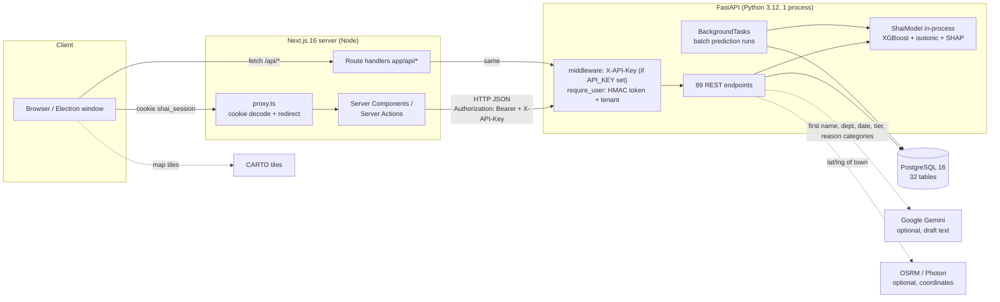
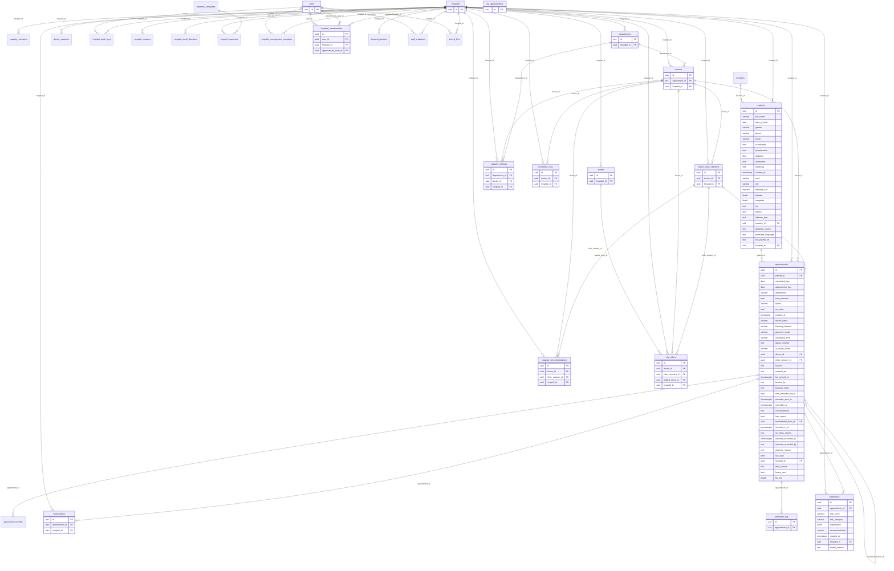

# SHAI — Thesis Fact Sheet (evidence-backed)

| | |
|---|---|
| **Generated** | 2026-10-03 (Asia/Colombo), ~23:20–23:50 |
| **Branch** | `viva-fixes` |
| **Commit this report is pinned to** | **`ac655bc`** ("Step 4: ROI from the database with replay on history and sensitivity table") — HEAD at the end of fact-gathering; full hash and the live `git status` are in the footer. Model/data/DB facts (§4–§14) were verified at `207ffbc`/`ac655bc` (no change to those areas between them). |
| **Method** | Read-only: `git`, `grep`, `psql` SELECT / `pg_dump --schema-only`, `python` scripts that only read (DB reads were rolled back, no commits), `pytest` against the *test* database `noshow_test_db`, `npm test`, `npm run lint`. Only files created: this report and `docs/thesis_figures/*.csv`. |
| **Secrets** | `SECRET_KEY`, `GEMINI_API_KEY`, password hashes and seeded demo passwords are NOT reproduced. Where the repo contains a demo password in plain text the location is given, the value is omitted. |

> ### ⚠ READ FIRST — the repository was changing while this report was written
> A second session was committing to `viva-fixes` during fact-gathering (HEAD moved `52ebf73 → 294ffad → 982ceba → 207ffbc → ac655bc` between 23:17 and 23:38; at the end an uncommitted rewrite of the capacity/overbooking maths — new `backend/app/services/overbooking.py`, migration `c2d3e4f5a6b8`, `queue_simulator.py` staged for deletion, new tests — was still in progress, and a concurrent `pytest` run by that session dropped the shared test schema once, which is why one of my runs was discarded).
> * Everything below describes **committed HEAD `ac655bc`**, except where a line says *in-flight/uncommitted*.
> * **Volatile items the thesis writer must re-check before quoting**: §15.2/§16 capacity & overbooking (Step 5 uncommitted), §19 test counts, §20 capacity screens. (Things that already changed during this session and are documented as such: Accuracy tab hard-coded → computed [`207ffbc`]; Model Hub rewritten [`982ceba`]; ROI parametric → replay [`ac655bc`]; revenue-at-risk fee 4,500×1.6 → per-appointment fee [`ac655bc`].)
> * The **database** is also live (counts moved by a few rows during the session: e.g. `users` 9→10, `waitlist` 0→7 between two snapshots, because `pg_stat` counts lag). All DB numbers in this report are exact `count(*)` queries taken at 23:20–23:31 on 2026-10-03.
> * `docs/AUDIT_FOR_CLAUDE.md` (dated 2026-10-02) is **stale**: its DB numbers (5,005 appointments, AUC 0.526) describe the database *before* the generator CSV was imported (commit `294ffad`). Do not quote it.

### Status tags used
**REAL** = implemented and evidenced · **PARTIAL** = works but incomplete/with caveats · **SIMULATED** = deliberately fake/demo · **MISSING** = not in the repo (written "NOT PRESENT").

### Section status overview
| § | Topic | Status |
|---|---|---|
| A1–A3 | Identity, architecture, repo map | REAL |
| B4–B5 | Schema, current data | REAL (all data **SYNTHETIC**) |
| B6 | Synthetic generator coefficients | **MISSING** (generator notebook not in repo; only empirical estimates + a legacy generator) |
| B7 | Kaggle | REAL (benchmark only, not in the deployed model) |
| C8–C9 | Bundle, model comparison | REAL; bootstrap CIs computed here (not in bundle) |
| C10 | Hypotheses / odds ratios | **MISSING** (no thesis/proposal in repo; odds ratios computed here) |
| C11–C12 | Calibration, SHAP, fairness | REAL numbers; **no fairness page in the app** (MISSING in UI) |
| C13 | End-to-end DB verification | REAL, with a flagged train-set-overlap caveat and a feature-alignment gap |
| C14 | Inference pipeline + latency | REAL |
| D15–D16 | Decision layer | PARTIAL (see per-item) |
| D17 | Waitlist/outreach/agent | PARTIAL / SIMULATED; nothing is sent to patients |
| E18 | Security/roles/privacy | PARTIAL |
| F19 | Tests | REAL (backend 173 passed at `ac655bc`; frontend 31 passed; **lint fails: 22 errors**) |
| G20–G21 | UI screens, design system | REAL / PARTIAL (see per-screen) |
| H22 | Requirements traceability | **MISSING** (no thesis/proposal/interim files in repo) |
| I23 | Limitations | — |
| J24 | Reproduction | PARTIAL |
| K25 | Thesis-vs-code mismatches | **MISSING** source thesis; stale repo-docs mismatches listed instead |

---

# A. SYSTEM IDENTITY  — REAL

## 1. Name, purpose, actors, deployment

**Name:** *SHAI — Smart Hospital AI Operations Platform* (`frontend/app/layout.tsx` metadata title; `README.md:1`). Repo folder/name: `ai-no-show-system`. API title string: "AI Patient No-Show Prediction System" (`backend/app/main.py:44`).

**What it does (one paragraph).** SHAI predicts, at booking time and again on the day, which outpatient appointments at a (Sri Lankan, private) hospital are likely to be no-shows. A calibrated XGBoost model produces a probability per appointment, a SHAP explanation of the top drivers, and a High/Medium/Low tier defined by capacity-based thresholds (top 10 % / next 20 % of validation risk). The probabilities feed: a triage dashboard and priority worklist, a Prediction Hub that batch-scores a day's clinic lists, a capacity page (expected no-shows with an 80 % interval, a Monte-Carlo-queue overbooking recommendation, a slot heatmap, what-if studio, forecast), a waitlist/slot-offer module, trilingual (EN/SI/TA) reminder drafting with Gemini (draft only, nothing sent), a rule-based "patient agent" simulator, an ROI simulator, analytics (no-show trend, revenue at risk, patient map) and a Model Hub that renders the model bundle's metadata. **All training and demo data are synthetic**; the model has never been validated on real hospital outcomes (`backend/app/shai_model.py:176-179` `LIMITATION`).

**Actors (roles in code):** `front_desk`, `analyst`, `manager`, `admin`, `platform_owner` (`backend/app/security.py:22-29`). A hospital patient is *not* a user; the "patient" in the agent simulator is typed text. External systems: a **simulated** HIS (table `his_appointments`), Google Gemini (optional), OSRM public router and Photon geocoder (optional, patient coordinates only), CARTO basemap tiles in the browser.

**Deployment shape.** Next.js 16 server (App Router, Server Components/Actions, route handlers under `app/api/*`, `proxy.ts` gate) → FastAPI (single process, model loaded in-process at import) → PostgreSQL 16. The browser never calls FastAPI directly. An optional **Electron 33** wrapper starts the bundled Next standalone server on a random 127.0.0.1 port and loads it in a window; the backend address is entered on a `/setup` screen and stored in `server-config.json` in Electron's user-data dir (`frontend/electron/main.js:29-52`, `frontend/lib/backend-config.ts`). Docker: `docker-compose.yml` (db `postgres:16-alpine`, backend, frontend), `docker-compose.prod.yml` + `deploy/Caddyfile` for HTTPS. CI: `.github/workflows/ci.yml` (backend pytest, frontend lint+test+build, docker build) and `desktop-release.yml` (Electron installers on `v*` tags). Evidence: `docker-compose.yml`, `deploy/DEPLOY.md`, `.github/workflows/`.

### Exact dependency versions (from lockfiles / pinned requirements / the running venv)
| Component | Version | Evidence |
|---|---|---|
| Python (backend venv) | **3.12.14** (`backend/venv/bin/python --version`); Docker `python:3.12-slim` (`backend/Dockerfile:1`); CI 3.12 | command output |
| Python (repo-root `.venv`, `.venv-1`) | 3.14.7 — **no ML packages installed, not used** | `…/.venv/bin/python -c "import xgboost"` → ModuleNotFoundError |
| Node / npm (local) | **v26.7.0 / 11.19.0**; CI uses Node 22 (`ci.yml`) | `node --version` |
| FastAPI / Starlette / Uvicorn | 0.141.1 / 1.6.0 / 0.52.4 | `backend/requirements.txt` |
| SQLAlchemy / Alembic / psycopg | 2.0.52 / 1.19.1 / 3.3.4 (+binary) | requirements.txt |
| Pydantic | 2.13.4 | requirements.txt |
| xgboost / shap / scikit-learn | **3.4.1 / 0.52.0 / 1.9.0** | requirements.txt; venv import printed `3.4.1 0.52.0 1.9.0` |
| pandas / numpy / scipy | 3.0.5 / 2.3.5 / 1.18.0 | requirements.txt |
| google-genai | 2.25.0 | requirements.txt |
| pytest / httpx / matplotlib (dev) | 9.1.1 / 0.28.1 / 3.11.2 | requirements-dev.txt |
| PostgreSQL | 16 (local Homebrew `postgresql@16`, `/usr/local/opt/postgresql@16/bin/postgres`; Docker `postgres:16-alpine`) | `ps`, docker-compose.yml |
| **Next.js** | **16.3.1** | `frontend/package-lock.json` |
| **React / react-dom** | **19.2.8** | package-lock |
| TypeScript / ESLint / Vitest | 5.9.3 / 9.39.5 / 4.1.11 | package-lock |
| Tailwind CSS | 4.3.3 (+ `@tailwindcss/postcss` ^4) | package-lock |
| UI libs | `@base-ui/react` 1.7.0, `shadcn` CLI 4.18.0, `lucide-react` 1.32.0, `recharts` 3.10.1, `maplibre-gl` 6.11.2, `motion` 13.4.6, `tw-animate-css` 1.4.0, `class-variance-authority` 0.7.1 | package-lock |
| **Electron / electron-builder** | **33.4.11 / 25.1.8** | package-lock |
| Testing Library (react) / jsdom | 16.3.3 / 30.0.1 | package-lock |

(`docs/SYSTEM_OVERVIEW.md` says "no charting library"; that is stale — `recharts` is a dependency.)

## 2. Architecture

**Components and how they talk**

| From → To | Protocol | Auth |
|---|---|---|
| Browser → Next.js server | HTTPS/HTTP; cookie `shai_session` (httpOnly, SameSite=Lax, `Secure` only if `SESSION_COOKIE_SECURE=true`; `frontend/lib/session.ts:sessionCookieOptions`) | signed token in cookie; `proxy.ts` only *decodes* it (no signature check) to redirect to `/login` |
| Next.js server (Server Components/Actions, `app/api/*` handlers) → FastAPI | HTTP JSON, `fetch(..., cache:"no-store")` (`frontend/lib/api.ts:100-135`) | headers `Authorization: Bearer <session token>` and `X-API-Key: <BACKEND_API_KEY>` (if configured) |
| FastAPI → PostgreSQL | SQLAlchemy 2 + psycopg3 (`postgresql+psycopg://`) | DB URL in env |
| FastAPI middleware | `X-API-Key` must equal `API_KEY` env for every non-public path, **only if `API_KEY` is set** (`main.py:125-140`); then `Depends(auth.require_user)` verifies the HMAC token and re-reads the user row (`auth.py:41-148`). **In the local dev environment `API_KEY` is not set** (`backend/.env` has no `API_KEY`; startup logs "API_KEY is not set"). |
| FastAPI → Gemini | HTTPS via `google-genai`, only if `GEMINI_API_KEY` set | API key env |
| FastAPI → OSRM (`http://router.project-osrm.org`) / Photon (`https://photon.komoot.io`) | **plain HTTP for OSRM**, 1.5 s timeout; default `ROUTING=osrm` (`geo_service.py:28-48`) | none |
| Browser → CARTO basemap | HTTPS (`frontend/lib/geo.ts:23`) | none |
| Electron main → bundled Next server | spawn `node` with `ELECTRON_RUN_AS_NODE=1` on 127.0.0.1 | n/a |

**What runs where.** The model (XGBoost `model.json`, isotonic points, thresholds, schema) is loaded once at import of `backend/app/main.py:32` (`shai = shai_model.ShaiModel()`); a `shap.TreeExplainer` is built at load. Batch prediction runs as a FastAPI `BackgroundTask` in the same process (`main.py:1323-1390`).



**Request flow — "register appointment → predict → show risk"** (the live path is the redesigned intake: `frontend/app/new/new-appointment-form.tsx:336,432`; the older `app/new/actions.ts` server action is **dead code**, not referenced by the form).

```mermaid
sequenceDiagram
  autonumber
  actor FD as Front-desk user
  participant UI as New Appointment form (browser)
  participant RH as Next route handler /api/*
  participant API as FastAPI
  participant S as scoring.score_appointment
  participant M as ShaiModel (XGBoost+isotonic+SHAP)
  participant DB as PostgreSQL
  FD->>UI: fill patient, dept, doctor, date, channel, payment, "heavy rain" toggle
  UI->>RH: POST /api/predict/preview (live, debounced)
  RH->>API: POST /predict/preview (Bearer + X-API-Key)
  API->>S: persist=False (nothing stored)
  S->>M: engineer → frame → score → calibrate → tier → SHAP top-6
  M-->>API: risk %, tier, drivers
  API-->>UI: preview card (risk + top-3 drivers)
  FD->>UI: Confirm
  UI->>RH: POST /api/appointments/intake
  RH->>API: POST /appointments/intake
  API->>DB: upsert patient (NIC / phone+name match), lock clinic session row, next queue token, INSERT appointment, INSERT appointment_events("booked")
  API->>S: score_appointment(persist=True, stage="booking")
  S->>DB: history query (prior outcomes) ; UPSERT predictions ; INSERT prediction_log (features JSON)
  API->>DB: COMMIT
  API-->>UI: IntakeResponse (patient, appointment, prediction, slot/token)
  UI-->>FD: risk badge + SHAP drivers + token
```

## 3. Repository map and size

Top-level (tracked files at `ac655bc`): `backend/` (FastAPI app, Alembic, ML scripts, model bundles, data, tests), `frontend/` (Next.js app, Electron wrapper), `docs/` (12 markdown files), `deploy/` (Caddyfile, DEPLOY.md), `docker-compose.yml`, `docker-compose.prod.yml`, `.github/workflows/`, `.claude/` (agent skills), `PLAN.md`, `README.md`, `LICENSE` (MIT).

| Path | Contents |
|---|---|
| `backend/app/` | `main.py` (2,328 lines at 207ffbc; core endpoints), `auth.py`, `security.py`, `models.py` (ORM), `schemas.py`, `shai_model.py` (bundle loader + feature engineering + Poya), `insights.py` (analytics/search/notifications), `hospital.py` (hospital profile/audit), `outreach_drafter.py` (Gemini), `geo.py`, `contextual.py` (**dead code**, see §23), `his/connector.py`, `services/` (`scoring`, `rescore`, `model_eval`, `capacity_service`, `capacity_math`, `queue_simulator`, `candidate_ranker`, `prediction_runner`, `his_sync`, `geo_service`, `synthetic_import`, `uhid`) |
| `backend/alembic/versions/` | 11 migrations, single head `b1c2d3e4f5a7` |
| `backend/models/` | `shai_bundle/` (**live**), `shai_bundle_v1-reproduced/`, legacy `xgboost_model.pkl` + `shap_explainer.pkl` (Kaggle-era, unused at runtime) |
| `backend/data/` | `KaggleV2-May-2016.csv`, `X.csv`/`y.csv` (Kaggle features), `sri_lanka_noshow.csv` (legacy 50k generator output), `appointments_synthetic.csv` (78,300 rows; **untracked in git** — `git status` shows `?? backend/data/appointments_synthetic.csv`; a byte-identical copy at `models/shai_bundle/appointments_synthetic.csv` is **git-ignored** by `.gitignore:9 backend/models/shai_bundle/*.csv`, as are `model_comparison_kaggle.csv` / `model_comparison_synthetic.csv`. A clean clone therefore has **no copy of the training/demo dataset**), `lk_locations.json` |
| `backend/tests/` | 23 test files (22 at `207ffbc`) |
| `frontend/app/` | 25 `page.tsx` routes + `app/api/*` route handlers; `components/` (65 files incl. `ui/` 19), `lib/` (api client, types, session, roi, features), `electron/` |

**Line counts** (no `cloc`/`tokei` installed; measured with `git ls-files … | xargs cat | wc -l`, includes blank lines/comments):
| Language | Lines |
|---|---|
| Python (all tracked) | 18,082 — of which `backend/app/**` 10,573; `backend/tests/**` 3,031 |
| TypeScript `.ts` | 3,874 |
| TSX `.tsx` | 19,651 — frontend app+components non-test (ts+tsx) 23,006; frontend tests 519 |
| JavaScript (Electron etc.) | 166 |
| CSS | 315 |
| Markdown | 3,089 |
| YAML | 220 |

---

# B. DATA — REAL (but all appointment data is SYNTHETIC)

## 4. Database schema (live DB `noshow_db`, Alembic head `b1c2d3e4f5a7`)

*Source of truth: `pg_dump --schema-only` of the live DB (`information_schema`, `pg_constraint`, `pg_indexes`), cross-checked with `backend/app/models.py` (693 lines) and the 11 migrations in `backend/alembic/versions/`. `alembic heads` → `b1c2d3e4f5a7 (head)`; `alembic_version` table holds the same value. 32 tables.*

Tables: `alembic_version`, `appointment_events`, `appointments`, `capacity_recommendations`, `capacity_scenarios`, `capacity_settings`, `departments`, `doctor_clinic_sessions`, `doctor_sessions` (legacy live-queue sessions), `doctors`, `expense_categories`, `his_appointments`, `his_sync_runs`, `hospital_audit_logs`, `hospital_contacts`, `hospital_email_domains`, `hospital_expenses`, `hospital_management_members`, `hospital_memberships`, `hospital_partners`, `hospitals`, `interventions`, `locations`, `patients`, `prediction_log`, `prediction_runs`, `predictions`, `slot_offers`, `staff_invitations`, `stored_files`, `users`, `waitlist`.

Notes that matter for the thesis:
* `appointments.no_show` is a nullable boolean = the label (NULL = not yet known or cancelled). `appointments.status` ∈ {scheduled, completed, no_show, cancelled, …}; `appointments.source` ∈ {manual, his_sync} (CHECK); `appointments.data_source` is free text (`synthetic` for all current rows; **NULL for rows created through the intake endpoint** because `main.py:create_appointment_intake` never sets it, nor `hospital_id`).
* `predictions.appointment_id` is UNIQUE (one current prediction per appointment, upserted); `prediction_log` is the append-only history (stage ∈ import/booking/day_of/rescore/preview) with the full feature dict in `features` JSONB.
* Multi-hospital tenancy columns (`hospital_id`) exist on most tables; several are **nullable** (e.g. `appointments.hospital_id`, `doctors.hospital_id`, `departments.hospital_id`) and several endpoints do not filter on them (see §18).

### ER diagram (all 48 foreign-key relationships; attributes shown for the core tables only)



### Full column / constraint / index listing (generated from the live DB)

#### `alembic_version`

| column | type | null | default |
|---|---|---|---|
| version_num | character varying(32) | N |  |

- **PK** `alembic_version_pkc`: PRIMARY KEY (version_num)
- **INDEX** `alembic_version_pkc`: btree (version_num)

#### `appointment_events`

| column | type | null | default |
|---|---|---|---|
| id | uuid | N | gen_random_uuid() |
| appointment_id | uuid | N |  |
| event_type | text | N |  |
| from_status | text | Y |  |
| to_status | text | Y |  |
| actor | text | Y |  |
| note | text | Y |  |
| payload | jsonb | N | '{}'::jsonb |
| created_at | timestamp with time zone | N | now() |

- **FK** `appointment_events_appointment_id_fkey`: FOREIGN KEY (appointment_id) REFERENCES appointments(id) ON DELETE CASCADE
- **PK** `appointment_events_pkey`: PRIMARY KEY (id)
- **INDEX** `ix_events_appt`: btree (appointment_id, created_at)

#### `appointments`

| column | type | null | default |
|---|---|---|---|
| id | uuid | N |  |
| patient_id | uuid | N |  |
| scheduled_day | date | N |  |
| appointment_day | date | N |  |
| department | character varying | Y |  |
| sms_received | boolean | N |  |
| status | character varying | N |  |
| no_show | boolean | Y |  |
| created_at | timestamp without time zone | N | now() |
| doctor_name | character varying | Y |  |
| booking_channel | character varying | Y |  |
| payment_mode | character varying | Y |  |
| scheduled_time | character varying | Y |  |
| queue_number | integer | Y |  |
| ai_action_status | character varying | Y |  |
| doctor_id | uuid | Y |  |
| clinic_session_id | uuid | Y |  |
| source | text | N | 'manual'::text |
| external_ref | text | Y |  |
| his_synced_at | timestamp with time zone | Y |  |
| booked_by | text | Y |  |
| booking_notes | text | Y |  |
| sms_reminder_opt_in | boolean | N | false |
| reminder_sent_at | timestamp with time zone | Y |  |
| cancelled_at | timestamp with time zone | Y |  |
| cancel_reason | text | Y |  |
| late_cancel | boolean | N | false |
| rescheduled_from_id | uuid | Y |  |
| checked_in_at | timestamp with time zone | Y |  |
| no_show_reason | text | Y |  |
| outcome_recorded_at | timestamp with time zone | Y |  |
| outcome_recorded_by | text | Y |  |
| outcome_source | text | Y |  |
| slot_start | time without time zone | Y |  |
| hospital_id | uuid | Y |  |
| data_source | text | Y |  |
| heavy_rain | boolean | N | false |
| fee_lkr | double precision | Y |  |

- **CHECK** `ck_appt_outcome_source`: CHECK (((outcome_source = ANY (ARRAY['staff'::text, 'system'::text, 'his_sync'::text])) OR (outcome_source IS NULL)))
- **CHECK** `ck_appt_source`: CHECK ((source = ANY (ARRAY['manual'::text, 'his_sync'::text])))
- **FK** `appointments_clinic_session_id_fkey`: FOREIGN KEY (clinic_session_id) REFERENCES doctor_clinic_sessions(id)
- **FK** `appointments_doctor_id_fkey`: FOREIGN KEY (doctor_id) REFERENCES doctors(id)
- **FK** `appointments_patient_id_fkey`: FOREIGN KEY (patient_id) REFERENCES patients(id)
- **FK** `appointments_rescheduled_from_id_fkey`: FOREIGN KEY (rescheduled_from_id) REFERENCES appointments(id)
- **FK** `fk_appointments_hospital_id`: FOREIGN KEY (hospital_id) REFERENCES hospitals(id) ON DELETE CASCADE
- **PK** `appointments_pkey`: PRIMARY KEY (id)
- **INDEX** `ix_appointments_data_source`: btree (data_source)
- **INDEX** `ix_appointments_doctor_date`: btree (doctor_id, appointment_day)
- **INDEX** `ix_appointments_hospital_id`: btree (hospital_id)
- **INDEX** `ix_appointments_session_slot`: btree (clinic_session_id, slot_start)
- **INDEX** `ix_appt_day_doctor`: btree (appointment_day, doctor_id)
- **INDEX** `uq_appt_external`: btree (source, external_ref) WHERE (external_ref IS NOT NULL)
- **INDEX** `uq_appt_patient_doctor_day`: btree (patient_id, doctor_id, appointment_day) WHERE (((status)::text = 'scheduled'::text) AND (doctor_id IS NOT NULL))
- **INDEX** `uq_appt_token`: btree (doctor_id, appointment_day, clinic_session_id, queue_number) WHERE ((source = 'manual'::text) AND ((status)::text <> 'cancelled'::text) AND (queue_number IS NOT NULL))

#### `capacity_recommendations`

| column | type | null | default |
|---|---|---|---|
| id | uuid | N | gen_random_uuid() |
| run_id | uuid | N |  |
| doctor_id | uuid | N |  |
| clinic_session_id | uuid | Y |  |
| slot_time | time without time zone | Y |  |
| target_date | date | N |  |
| booked_count | integer | N | 0 |
| expected_no_shows | double precision | N | '0'::double precision |
| interval_low | double precision | N | '0'::double precision |
| interval_high | double precision | N | '0'::double precision |
| recommended_overbook | integer | N | 0 |
| expected_wait_mins | double precision | N | '0'::double precision |
| expected_revenue_lkr | double precision | N | '0'::double precision |
| p_overcrowding | double precision | N | '0'::double precision |
| effective_tolerance_mins | integer | N | 15 |
| settings_snapshot | jsonb | N | '{}'::jsonb |
| model_version | text | N | 'shai-lk-synth-v1'::text |
| created_at | timestamp with time zone | N | now() |
| hospital_id | uuid | Y |  |

- **FK** `capacity_recommendations_clinic_session_id_fkey`: FOREIGN KEY (clinic_session_id) REFERENCES doctor_clinic_sessions(id) ON DELETE SET NULL
- **FK** `capacity_recommendations_doctor_id_fkey`: FOREIGN KEY (doctor_id) REFERENCES doctors(id) ON DELETE CASCADE
- **FK** `fk_capacity_recommendations_hospital_id`: FOREIGN KEY (hospital_id) REFERENCES hospitals(id) ON DELETE CASCADE
- **PK** `capacity_recommendations_pkey`: PRIMARY KEY (id)
- **INDEX** `ix_capacity_rec_date_doc`: btree (target_date, doctor_id)
- **INDEX** `ix_capacity_recommendations_hospital_id`: btree (hospital_id)

#### `capacity_scenarios`

| column | type | null | default |
|---|---|---|---|
| id | uuid | N | gen_random_uuid() |
| name | text | N |  |
| params | jsonb | N | '{}'::jsonb |
| results | jsonb | N | '{}'::jsonb |
| created_by | text | Y |  |
| created_at | timestamp with time zone | N | now() |
| hospital_id | uuid | Y |  |

- **FK** `fk_capacity_scenarios_hospital_id`: FOREIGN KEY (hospital_id) REFERENCES hospitals(id) ON DELETE CASCADE
- **PK** `capacity_scenarios_pkey`: PRIMARY KEY (id)
- **INDEX** `ix_capacity_scenarios_hospital_id`: btree (hospital_id)

#### `capacity_settings`

| column | type | null | default |
|---|---|---|---|
| id | uuid | N | gen_random_uuid() |
| scope | text | N | 'global'::text |
| department_id | integer | Y |  |
| doctor_id | uuid | Y |  |
| safety_factor | double precision | N | '0.75'::double precision |
| max_overbook_per_slot | integer | N | 2 |
| max_overbook_per_session | integer | N | 4 |
| wait_tolerance_mins | integer | N | 15 |
| consultation_fee_lkr | double precision | N | '4500'::double precision |
| badge_safe_mins | integer | N | 8 |
| badge_moderate_mins | integer | N | 15 |
| auto_assign_waitlist | boolean | N | false |
| sim_runs | integer | N | 2000 |
| created_at | timestamp with time zone | N | now() |
| updated_at | timestamp with time zone | N | now() |
| hospital_id | uuid | Y |  |

- **FK** `capacity_settings_department_id_fkey`: FOREIGN KEY (department_id) REFERENCES departments(id) ON DELETE CASCADE
- **FK** `capacity_settings_doctor_id_fkey`: FOREIGN KEY (doctor_id) REFERENCES doctors(id) ON DELETE CASCADE
- **FK** `fk_capacity_settings_hospital_id`: FOREIGN KEY (hospital_id) REFERENCES hospitals(id) ON DELETE CASCADE
- **PK** `capacity_settings_pkey`: PRIMARY KEY (id)
- **INDEX** `ix_capacity_settings_hospital_id`: btree (hospital_id)
- **INDEX** `ix_capacity_settings_scope`: btree (scope, department_id, doctor_id)

#### `departments`

| column | type | null | default |
|---|---|---|---|
| id | integer | N | nextval('departments_id_seq'::regclass) |
| name | text | N |  |
| model_category | text | Y |  |
| icon | text | N | 'stethoscope'::text |
| telehealth_ok | boolean | N | false |
| active | boolean | N | true |
| default_consultation_fee_lkr | double precision | N | '4500'::double precision |
| hospital_id | uuid | Y |  |

- **FK** `fk_departments_hospital_id`: FOREIGN KEY (hospital_id) REFERENCES hospitals(id) ON DELETE CASCADE
- **PK** `departments_pkey`: PRIMARY KEY (id)
- **UNIQUE** `departments_name_key`: UNIQUE (name)
- **INDEX** `departments_name_key`: btree (name)
- **INDEX** `ix_departments_hospital_id`: btree (hospital_id)

#### `doctor_clinic_sessions`

| column | type | null | default |
|---|---|---|---|
| id | uuid | N | gen_random_uuid() |
| doctor_id | uuid | N |  |
| weekday | smallint | N |  |
| label | text | N |  |
| start_time | time without time zone | N |  |
| end_time | time without time zone | N |  |
| room | text | N |  |
| max_patients | integer | N | 25 |
| slot_minutes | integer | N | 12 |
| active | boolean | N | true |
| delay_minutes | integer | N | 0 |
| delay_status | text | N | 'on_time'::text |
| hospital_id | uuid | Y |  |

- **CHECK** `ck_session_label`: CHECK ((label = ANY (ARRAY['Morning'::text, 'Afternoon'::text, 'Evening'::text])))
- **CHECK** `ck_session_weekday`: CHECK (((weekday >= 0) AND (weekday <= 6)))
- **FK** `doctor_clinic_sessions_doctor_id_fkey`: FOREIGN KEY (doctor_id) REFERENCES doctors(id) ON DELETE CASCADE
- **FK** `fk_doctor_clinic_sessions_hospital_id`: FOREIGN KEY (hospital_id) REFERENCES hospitals(id) ON DELETE CASCADE
- **PK** `doctor_clinic_sessions_pkey`: PRIMARY KEY (id)
- **UNIQUE** `uq_doctor_weekday_label`: UNIQUE (doctor_id, weekday, label)
- **INDEX** `ix_doctor_clinic_sessions_hospital_id`: btree (hospital_id)
- **INDEX** `uq_doctor_weekday_label`: btree (doctor_id, weekday, label)

#### `doctor_sessions`

| column | type | null | default |
|---|---|---|---|
| id | uuid | N |  |
| doctor_name | character varying | N |  |
| specialty | character varying | N |  |
| room_number | character varying | N |  |
| session_date | date | N |  |
| scheduled_start_time | character varying | N |  |
| status | character varying | N |  |
| delay_minutes | integer | N |  |
| avg_consultation_mins | integer | N |  |
| max_capacity | integer | N |  |
| created_at | timestamp without time zone | N | now() |
| hospital_id | uuid | Y |  |

- **FK** `fk_doctor_sessions_hospital_id`: FOREIGN KEY (hospital_id) REFERENCES hospitals(id) ON DELETE CASCADE
- **PK** `doctor_sessions_pkey`: PRIMARY KEY (id)
- **INDEX** `ix_doctor_sessions_hospital_id`: btree (hospital_id)

#### `doctors`

| column | type | null | default |
|---|---|---|---|
| id | uuid | N | gen_random_uuid() |
| title | text | N | 'Dr.'::text |
| full_name | text | N |  |
| department_id | integer | N |  |
| his_doctor_code | text | Y |  |
| default_room | text | Y |  |
| active | boolean | N | true |
| needs_review | boolean | N | false |
| created_at | timestamp with time zone | N | now() |
| consultation_fee_lkr | double precision | N | '4500'::double precision |
| hospital_id | uuid | Y |  |

- **FK** `doctors_department_id_fkey`: FOREIGN KEY (department_id) REFERENCES departments(id)
- **FK** `fk_doctors_hospital_id`: FOREIGN KEY (hospital_id) REFERENCES hospitals(id) ON DELETE CASCADE
- **PK** `doctors_pkey`: PRIMARY KEY (id)
- **UNIQUE** `doctors_his_doctor_code_key`: UNIQUE (his_doctor_code)
- **INDEX** `doctors_his_doctor_code_key`: btree (his_doctor_code)
- **INDEX** `ix_doctors_department`: btree (department_id) WHERE (active = true)
- **INDEX** `ix_doctors_hospital_id`: btree (hospital_id)

#### `expense_categories`

| column | type | null | default |
|---|---|---|---|
| id | uuid | N |  |
| key | character varying | N |  |
| name | character varying | N |  |
| icon | character varying | N | 'receipt'::character varying |
| description | text | Y |  |
| display_order | integer | N | 0 |

- **PK** `expense_categories_pkey`: PRIMARY KEY (id)
- **INDEX** `ix_expense_categories_key`: btree (key)

#### `his_appointments`

| column | type | null | default |
|---|---|---|---|
| id | uuid | N | gen_random_uuid() |
| his_ref | text | N |  |
| his_patient_ref | text | N |  |
| patient_name | text | N |  |
| date_of_birth | date | N |  |
| gender | text | Y |  |
| phone | text | Y |  |
| nic | text | Y |  |
| city | text | Y |  |
| doctor_code | text | N |  |
| doctor_name | text | N |  |
| department | text | N |  |
| appointment_date | date | N |  |
| appointment_time | time without time zone | N |  |
| booked_on | date | N |  |
| booking_channel | text | Y |  |
| payment_mode | text | Y |  |
| token_no | integer | Y |  |
| his_status | text | N | 'booked'::text |
| hypertension | boolean | Y |  |
| diabetes | boolean | Y |  |
| alcoholism | boolean | Y |  |
| handicap | integer | Y |  |
| scholarship | boolean | Y |  |
| sms_sent | boolean | Y |  |
| updated_at | timestamp with time zone | N | now() |

- **CHECK** `ck_his_status`: CHECK ((his_status = ANY (ARRAY['booked'::text, 'arrived'::text, 'completed'::text, 'no_show'::text, 'cancelled'::text])))
- **PK** `his_appointments_pkey`: PRIMARY KEY (id)
- **UNIQUE** `his_appointments_his_ref_key`: UNIQUE (his_ref)
- **INDEX** `his_appointments_his_ref_key`: btree (his_ref)
- **INDEX** `ix_his_appt_date`: btree (appointment_date)

#### `his_sync_runs`

| column | type | null | default |
|---|---|---|---|
| id | uuid | N | gen_random_uuid() |
| target_date | date | N |  |
| trigger | text | N |  |
| status | text | N |  |
| fetched | integer | N | 0 |
| created | integer | N | 0 |
| updated | integer | N | 0 |
| unchanged | integer | N | 0 |
| failed | integer | N | 0 |
| error | text | Y |  |
| triggered_by | text | Y |  |
| started_at | timestamp with time zone | N | now() |
| finished_at | timestamp with time zone | Y |  |

- **CHECK** `ck_sync_status`: CHECK ((status = ANY (ARRAY['running'::text, 'done'::text, 'failed'::text])))
- **CHECK** `ck_sync_trigger`: CHECK ((trigger = ANY (ARRAY['manual'::text, 'auto'::text, 'combined_run'::text])))
- **PK** `his_sync_runs_pkey`: PRIMARY KEY (id)

#### `hospital_audit_logs`

| column | type | null | default |
|---|---|---|---|
| id | uuid | N |  |
| hospital_id | uuid | N |  |
| user_id | uuid | Y |  |
| action | character varying | N |  |
| entity_type | character varying | N |  |
| entity_id | character varying | Y |  |
| details | jsonb | N | '{}'::jsonb |
| ip_address | character varying | Y |  |
| created_at | timestamp with time zone | N | now() |

- **FK** `hospital_audit_logs_hospital_id_fkey`: FOREIGN KEY (hospital_id) REFERENCES hospitals(id) ON DELETE CASCADE
- **FK** `hospital_audit_logs_user_id_fkey`: FOREIGN KEY (user_id) REFERENCES users(id) ON DELETE SET NULL
- **PK** `hospital_audit_logs_pkey`: PRIMARY KEY (id)
- **INDEX** `ix_hospital_audit_logs_hospital_id`: btree (hospital_id)

#### `hospital_contacts`

| column | type | null | default |
|---|---|---|---|
| id | uuid | N |  |
| hospital_id | uuid | N |  |
| kind | character varying | N |  |
| name | character varying | N |  |
| title | character varying | Y |  |
| email | character varying | Y |  |
| phone | character varying | Y |  |
| is_primary | boolean | N | false |

- **FK** `hospital_contacts_hospital_id_fkey`: FOREIGN KEY (hospital_id) REFERENCES hospitals(id) ON DELETE CASCADE
- **PK** `hospital_contacts_pkey`: PRIMARY KEY (id)

#### `hospital_email_domains`

| column | type | null | default |
|---|---|---|---|
| id | uuid | N |  |
| hospital_id | uuid | N |  |
| domain | character varying | N |  |
| is_primary | boolean | N | false |
| created_at | timestamp with time zone | N | now() |
| is_verified | boolean | N | true |

- **FK** `hospital_email_domains_hospital_id_fkey`: FOREIGN KEY (hospital_id) REFERENCES hospitals(id) ON DELETE CASCADE
- **PK** `hospital_email_domains_pkey`: PRIMARY KEY (id)
- **INDEX** `ix_hospital_email_domains_domain`: btree (domain)
- **INDEX** `ix_hospital_email_domains_hospital_id`: btree (hospital_id)

#### `hospital_expenses`

| column | type | null | default |
|---|---|---|---|
| id | uuid | N |  |
| hospital_name | character varying | N | 'Default Hospital'::character varying |
| category_id | uuid | N |  |
| title | character varying | N |  |
| amount_lkr | double precision | N | '0'::double precision |
| recurrence | character varying | N | 'annual'::character varying |
| is_active | boolean | N | true |
| notes | text | Y |  |
| created_at | timestamp with time zone | N | now() |
| updated_at | timestamp with time zone | N | now() |
| hospital_id | uuid | Y |  |

- **FK** `fk_hospital_expenses_hospital_id`: FOREIGN KEY (hospital_id) REFERENCES hospitals(id) ON DELETE CASCADE
- **FK** `hospital_expenses_category_id_fkey`: FOREIGN KEY (category_id) REFERENCES expense_categories(id) ON DELETE CASCADE
- **PK** `hospital_expenses_pkey`: PRIMARY KEY (id)
- **INDEX** `ix_hospital_expenses_hospital_id`: btree (hospital_id)

#### `hospital_management_members`

| column | type | null | default |
|---|---|---|---|
| id | uuid | N |  |
| hospital_id | uuid | N |  |
| user_id | uuid | Y |  |
| full_name | character varying | N |  |
| position | character varying | N |  |
| photo_file_id | uuid | Y |  |
| bio | text | Y |  |
| email | character varying | Y |  |
| phone | character varying | Y |  |
| display_order | integer | N | 0 |
| is_public | boolean | N | true |

- **FK** `hospital_management_members_hospital_id_fkey`: FOREIGN KEY (hospital_id) REFERENCES hospitals(id) ON DELETE CASCADE
- **FK** `hospital_management_members_user_id_fkey`: FOREIGN KEY (user_id) REFERENCES users(id) ON DELETE SET NULL
- **PK** `hospital_management_members_pkey`: PRIMARY KEY (id)

#### `hospital_memberships`

| column | type | null | default |
|---|---|---|---|
| id | uuid | N |  |
| user_id | uuid | N |  |
| hospital_id | uuid | N |  |
| role | character varying | N | 'front_desk'::character varying |
| is_active | boolean | N | true |
| job_title | character varying | Y |  |
| department_id | integer | Y |  |
| employee_code | character varying | Y |  |
| joined_at | timestamp with time zone | N | now() |
| status | character varying | N | 'active'::character varying |
| invited_or_requested_role | character varying | Y |  |
| approved_at | timestamp with time zone | Y |  |
| approved_by_user_id | uuid | Y |  |

- **FK** `hospital_memberships_approved_by_user_id_fkey`: FOREIGN KEY (approved_by_user_id) REFERENCES users(id) ON DELETE SET NULL
- **FK** `hospital_memberships_hospital_id_fkey`: FOREIGN KEY (hospital_id) REFERENCES hospitals(id) ON DELETE CASCADE
- **FK** `hospital_memberships_user_id_fkey`: FOREIGN KEY (user_id) REFERENCES users(id) ON DELETE CASCADE
- **PK** `hospital_memberships_pkey`: PRIMARY KEY (id)
- **UNIQUE** `uq_user_hospital_membership`: UNIQUE (user_id, hospital_id)
- **INDEX** `ix_hospital_memberships_hospital_id`: btree (hospital_id)
- **INDEX** `ix_hospital_memberships_status`: btree (status)
- **INDEX** `ix_hospital_memberships_user_id`: btree (user_id)
- **INDEX** `uq_user_hospital_membership`: btree (user_id, hospital_id)

#### `hospital_partners`

| column | type | null | default |
|---|---|---|---|
| id | uuid | N |  |
| hospital_id | uuid | N |  |
| name | character varying | N |  |
| kind | character varying | N |  |
| logo_file_id | uuid | Y |  |
| website | character varying | Y |  |
| since_date | date | Y |  |
| description | text | Y |  |
| is_official | boolean | N | true |

- **FK** `hospital_partners_hospital_id_fkey`: FOREIGN KEY (hospital_id) REFERENCES hospitals(id) ON DELETE CASCADE
- **PK** `hospital_partners_pkey`: PRIMARY KEY (id)

#### `hospitals`

| column | type | null | default |
|---|---|---|---|
| id | uuid | N |  |
| slug | character varying | N |  |
| name | character varying | N |  |
| short_name | character varying | N |  |
| legal_name | character varying | Y |  |
| logo_file_id | uuid | Y |  |
| logo_url | character varying | Y |  |
| brand_color | character varying | N | '#8B7CF6'::character varying |
| established_date | date | Y |  |
| hospital_type | character varying | N | 'private'::character varying |
| registration_number | character varying | Y |  |
| bed_count | integer | N | 0 |
| address_line1 | character varying | Y |  |
| address_line2 | character varying | Y |  |
| city | character varying | N | 'Colombo'::character varying |
| district | character varying | N | 'Colombo'::character varying |
| province | character varying | N | 'Western'::character varying |
| postal_code | character varying | N | '01000'::character varying |
| country | character varying | N | 'Sri Lanka'::character varying |
| latitude | double precision | N | '6.9271'::double precision |
| longitude | double precision | N | '79.8612'::double precision |
| timezone | character varying | N | 'Asia/Colombo'::character varying |
| currency | character varying | N | 'LKR'::character varying |
| website | character varying | Y |  |
| main_phone | character varying | Y |  |
| main_email | character varying | Y |  |
| emergency_phone | character varying | Y |  |
| about | text | Y |  |
| accreditations | jsonb | N | '[]'::jsonb |
| go_live_date | date | Y |  |
| is_active | boolean | N | true |
| created_at | timestamp with time zone | N | now() |
| updated_at | timestamp with time zone | N | now() |

- **PK** `hospitals_pkey`: PRIMARY KEY (id)
- **INDEX** `ix_hospitals_slug`: btree (slug)

#### `interventions`

| column | type | null | default |
|---|---|---|---|
| id | uuid | N |  |
| appointment_id | uuid | N |  |
| channel | character varying | N |  |
| language | character varying | N |  |
| status | character varying | N |  |
| patient_reply | character varying | Y |  |
| intent_detected | character varying | Y |  |
| offered_slot | character varying | Y |  |
| created_at | timestamp without time zone | N | now() |
| hospital_id | uuid | Y |  |

- **FK** `fk_interventions_hospital_id`: FOREIGN KEY (hospital_id) REFERENCES hospitals(id) ON DELETE CASCADE
- **FK** `interventions_appointment_id_fkey`: FOREIGN KEY (appointment_id) REFERENCES appointments(id)
- **PK** `interventions_pkey`: PRIMARY KEY (id)
- **INDEX** `ix_interventions_hospital_id`: btree (hospital_id)

#### `locations`

| column | type | null | default |
|---|---|---|---|
| id | integer | N | nextval('locations_id_seq'::regclass) |
| name | text | N |  |
| name_norm | text | N |  |
| district | text | Y |  |
| province | text | Y |  |
| kind | text | N | 'town'::text |
| latitude | double precision | N |  |
| longitude | double precision | N |  |
| population | integer | Y |  |
| aliases | ARRAY | N | '{}'::text[] |
| source | text | N | 'geonames'::text |

- **PK** `locations_pkey`: PRIMARY KEY (id)
- **UNIQUE** `uq_locations_norm_district`: UNIQUE (name_norm, district)
- **INDEX** `ix_locations_trgm`: gin (name_norm gin_trgm_ops)
- **INDEX** `uq_locations_norm_district`: btree (name_norm, district)

#### `patients`

| column | type | null | default |
|---|---|---|---|
| id | uuid | N |  |
| full_name | character varying | N |  |
| date_of_birth | date | N |  |
| gender | character varying | Y |  |
| phone | character varying | Y |  |
| email | character varying | Y |  |
| scholarship | boolean | N |  |
| hypertension | boolean | N |  |
| diabetes | boolean | N |  |
| alcoholism | boolean | N |  |
| handicap | integer | N |  |
| created_at | timestamp without time zone | N | now() |
| uhid | character varying | N |  |
| city | character varying | Y |  |
| distance_km | numeric | Y |  |
| latitude | double precision | Y |  |
| longitude | double precision | Y |  |
| nic | text | Y |  |
| district | text | Y |  |
| address_line | text | Y |  |
| location_id | integer | Y |  |
| distance_source | text | Y |  |
| preferred_language | text | N | 'en'::text |
| his_patient_ref | text | Y |  |
| hospital_id | uuid | Y |  |

- **CHECK** `ck_patient_dist_source`: CHECK (((distance_source = ANY (ARRAY['road_osrm'::text, 'estimated'::text, 'manual'::text])) OR (distance_source IS NULL)))
- **CHECK** `ck_patient_pref_lang`: CHECK ((preferred_language = ANY (ARRAY['en'::text, 'si'::text, 'ta'::text])))
- **FK** `fk_patients_hospital_id`: FOREIGN KEY (hospital_id) REFERENCES hospitals(id) ON DELETE CASCADE
- **FK** `patients_location_id_fkey`: FOREIGN KEY (location_id) REFERENCES locations(id)
- **PK** `patients_pkey`: PRIMARY KEY (id)
- **INDEX** `ix_patients_hospital_id`: btree (hospital_id)
- **INDEX** `ix_patients_name_trgm`: gin (lower((full_name)::text) gin_trgm_ops)
- **INDEX** `ix_patients_nic`: btree (nic) WHERE (nic IS NOT NULL)
- **INDEX** `ix_patients_phone`: btree (phone)
- **INDEX** `uq_patients_his_ref`: btree (his_patient_ref) WHERE (his_patient_ref IS NOT NULL)
- **INDEX** `uq_patients_uhid`: btree (uhid)

#### `prediction_log`

| column | type | null | default |
|---|---|---|---|
| id | uuid | N | gen_random_uuid() |
| appointment_id | uuid | N |  |
| stage | text | N |  |
| features | jsonb | N |  |
| risk_score | numeric | N |  |
| risk_category | text | N |  |
| model_version | text | N |  |
| prediction_run_id | uuid | Y |  |
| created_at | timestamp with time zone | N | now() |

- **CHECK** `ck_predlog_stage`: CHECK ((stage = ANY (ARRAY['booking'::text, 'import'::text, 'rescore'::text])))
- **FK** `prediction_log_appointment_id_fkey`: FOREIGN KEY (appointment_id) REFERENCES appointments(id) ON DELETE CASCADE
- **PK** `prediction_log_pkey`: PRIMARY KEY (id)
- **INDEX** `ix_predlog_appt`: btree (appointment_id, created_at)

#### `prediction_runs`

| column | type | null | default |
|---|---|---|---|
| id | uuid | N | gen_random_uuid() |
| run_date | date | N |  |
| doctor_id | uuid | Y |  |
| status | text | N |  |
| stage | text | N | 'queued'::text |
| with_sync | boolean | N | false |
| total | integer | N | 0 |
| scored | integer | N | 0 |
| failed | integer | N | 0 |
| high | integer | N | 0 |
| medium | integer | N | 0 |
| low | integer | N | 0 |
| expected_no_shows | numeric | Y |  |
| model_version | text | Y |  |
| error | text | Y |  |
| triggered_by | text | Y |  |
| started_at | timestamp with time zone | N | now() |
| finished_at | timestamp with time zone | Y |  |
| hospital_id | uuid | Y |  |

- **CHECK** `ck_pred_run_status`: CHECK ((status = ANY (ARRAY['queued'::text, 'running'::text, 'done'::text, 'failed'::text])))
- **FK** `fk_prediction_runs_hospital_id`: FOREIGN KEY (hospital_id) REFERENCES hospitals(id) ON DELETE CASCADE
- **FK** `prediction_runs_doctor_id_fkey`: FOREIGN KEY (doctor_id) REFERENCES doctors(id)
- **PK** `prediction_runs_pkey`: PRIMARY KEY (id)
- **INDEX** `ix_prediction_runs_hospital_id`: btree (hospital_id)

#### `predictions`

| column | type | null | default |
|---|---|---|---|
| id | uuid | N |  |
| appointment_id | uuid | N |  |
| risk_score | numeric | N |  |
| risk_category | character varying | N |  |
| explanation | jsonb | N |  |
| recommendation | character varying | N |  |
| created_at | timestamp without time zone | N | now() |
| hospital_id | uuid | Y |  |
| model_version | text | Y |  |

- **FK** `fk_predictions_hospital_id`: FOREIGN KEY (hospital_id) REFERENCES hospitals(id) ON DELETE CASCADE
- **FK** `predictions_appointment_id_fkey`: FOREIGN KEY (appointment_id) REFERENCES appointments(id)
- **PK** `predictions_pkey`: PRIMARY KEY (id)
- **UNIQUE** `predictions_appointment_id_key`: UNIQUE (appointment_id)
- **INDEX** `ix_predictions_hospital_id`: btree (hospital_id)
- **INDEX** `predictions_appointment_id_key`: btree (appointment_id)

#### `slot_offers`

| column | type | null | default |
|---|---|---|---|
| id | uuid | N | gen_random_uuid() |
| doctor_id | uuid | N |  |
| clinic_session_id | uuid | Y |  |
| slot_time | time without time zone | N |  |
| slot_date | date | N |  |
| freed_reason | text | N |  |
| waitlist_entry_id | uuid | N |  |
| match_score | double precision | N | '0'::double precision |
| score_breakdown | jsonb | N | '{}'::jsonb |
| status | text | N | 'proposed'::text |
| acted_by | text | Y |  |
| acted_at | timestamp with time zone | Y |  |
| expires_at | timestamp with time zone | Y |  |
| created_at | timestamp with time zone | N | now() |
| hospital_id | uuid | Y |  |

- **FK** `fk_slot_offers_hospital_id`: FOREIGN KEY (hospital_id) REFERENCES hospitals(id) ON DELETE CASCADE
- **FK** `slot_offers_clinic_session_id_fkey`: FOREIGN KEY (clinic_session_id) REFERENCES doctor_clinic_sessions(id) ON DELETE SET NULL
- **FK** `slot_offers_doctor_id_fkey`: FOREIGN KEY (doctor_id) REFERENCES doctors(id) ON DELETE CASCADE
- **FK** `slot_offers_waitlist_entry_id_fkey`: FOREIGN KEY (waitlist_entry_id) REFERENCES waitlist(id) ON DELETE CASCADE
- **PK** `slot_offers_pkey`: PRIMARY KEY (id)
- **INDEX** `ix_slot_offers_hospital_id`: btree (hospital_id)
- **INDEX** `ix_slot_offers_status`: btree (status, slot_date)

#### `staff_invitations`

| column | type | null | default |
|---|---|---|---|
| id | uuid | N |  |
| email | character varying | N |  |
| hospital_id | uuid | N |  |
| role | character varying | N |  |
| invited_by | uuid | Y |  |
| token_hash | character varying | N |  |
| expires_at | timestamp with time zone | N |  |
| accepted_at | timestamp with time zone | Y |  |
| status | character varying | N | 'pending'::character varying |
| created_at | timestamp with time zone | N | now() |

- **FK** `staff_invitations_hospital_id_fkey`: FOREIGN KEY (hospital_id) REFERENCES hospitals(id) ON DELETE CASCADE
- **FK** `staff_invitations_invited_by_fkey`: FOREIGN KEY (invited_by) REFERENCES users(id) ON DELETE SET NULL
- **PK** `staff_invitations_pkey`: PRIMARY KEY (id)
- **INDEX** `ix_staff_invitations_email`: btree (email)
- **INDEX** `ix_staff_invitations_token_hash`: btree (token_hash)

#### `stored_files`

| column | type | null | default |
|---|---|---|---|
| id | uuid | N |  |
| hospital_id | uuid | Y |  |
| kind | character varying | N | 'image'::character varying |
| content_type | character varying | N |  |
| size | integer | N |  |
| sha256 | character varying | N |  |
| storage_path | character varying | N |  |
| uploaded_by | uuid | Y |  |
| created_at | timestamp with time zone | N | now() |

- **FK** `stored_files_hospital_id_fkey`: FOREIGN KEY (hospital_id) REFERENCES hospitals(id) ON DELETE CASCADE
- **FK** `stored_files_uploaded_by_fkey`: FOREIGN KEY (uploaded_by) REFERENCES users(id) ON DELETE SET NULL
- **PK** `stored_files_pkey`: PRIMARY KEY (id)

#### `users`

| column | type | null | default |
|---|---|---|---|
| id | uuid | N |  |
| email | character varying | N |  |
| full_name | character varying | N |  |
| role | character varying | N |  |
| password_hash | character varying | N |  |
| is_active | boolean | N |  |
| must_change_password | boolean | N |  |
| failed_attempts | integer | N |  |
| locked_until | timestamp with time zone | Y |  |
| last_login_at | timestamp with time zone | Y |  |
| created_at | timestamp without time zone | N | now() |
| phone | character varying | Y |  |
| avatar_file_id | uuid | Y |  |

- **PK** `users_pkey`: PRIMARY KEY (id)
- **INDEX** `ix_users_email`: btree (email)

#### `waitlist`

| column | type | null | default |
|---|---|---|---|
| id | uuid | N |  |
| patient_name | character varying | N |  |
| patient_phone | character varying | N |  |
| specialty | character varying | N |  |
| doctor_name | character varying | N |  |
| urgency_level | character varying | N |  |
| preferred_days | character varying | N |  |
| status | character varying | N |  |
| created_at | timestamp without time zone | N | now() |
| hospital_id | uuid | Y |  |

- **FK** `fk_waitlist_hospital_id`: FOREIGN KEY (hospital_id) REFERENCES hospitals(id) ON DELETE CASCADE
- **PK** `waitlist_pkey`: PRIMARY KEY (id)
- **INDEX** `ix_waitlist_hospital_id`: btree (hospital_id)

## 5. Current data (exact `count(*)` queries, 2026-10-03 23:20–23:31 IST)

### 5.1 Rows per table
| table | rows | | table | rows |
|---|---|---|---|---|
| appointments | **73,843** | | hospitals | 2 |
| patients | **39,032** | | hospital_memberships | 9 |
| predictions | 69,518 | | users | 10 |
| prediction_log | 69,518 | | hospital_email_domains | 4 |
| doctors | 68 (65 Asiri, 3 NHSL) | | hospital_audit_logs | 2 |
| doctor_clinic_sessions | 1,236 | | hospital_expenses | 2 |
| departments | 19 | | expense_categories | 5 |
| locations | 16,450 | | capacity_settings | 2 (duplicate `global` rows; one has fee 0) |
| his_appointments | 228 | | capacity_scenarios | 3 (one is junk text "wfewef") |
| his_sync_runs | 3 (2 failed, 1 done) | | waitlist | 7 (6 waiting, 1 offered) |
| prediction_runs | 3 (**all stuck `running/scoring`, scored=0, never finished**) | | slot_offers | 1 |
| doctor_sessions (legacy) | 17 | | interventions, appointment_events, capacity_recommendations, hospital_contacts, hospital_partners, hospital_management_members, staff_invitations, stored_files | 0 each |

### 5.2 Appointments by status × data_source × source (one hospital only)
```
hospital_id = a0000000-…-0001 (asiri-central) for ALL rows;  data_source='synthetic', source='manual' for ALL rows
status      count   min appt day  max appt day  with outcome  no-shows
cancelled    4,325  2024-11-19    2026-10-02          0            0
completed   57,752  2024-11-19    2026-10-02     57,752            0
no_show     11,102  2024-11-19    2026-10-02     11,102       11,102
scheduled      664  2026-10-03    2026-11-17          0            0
TOTAL       73,843  2024-11-19 → 2026-11-17
```
* **Date range:** appointments span 2024-11-19 … 2026-11-17 (history ends 2026-10-02; the future part is the 45-day synthetic schedule).
* **Future scheduled:** 664 (appointment_day ≥ 2026-10-03): 121 today (Sat 3 Oct), 12 on Sun 4 Oct, 101 on Mon 5 Oct, 52 on Tue, 35 Wed, 27 Thu, 28 Fri …
* **With outcomes:** 68,854 non-cancelled appointments have a recorded outcome (57,752 attended + 11,102 no-show). **Observed no-show rate = 11,102 / 68,854 = 16.12 %** (cancelled rows excluded from the denominator; including them: 11,102/73,179 history rows = 15.17 %).
* **Tier distribution of stored predictions** (69,518 = all non-cancelled appointments, model `shai-lk-synth-v1`): High 5,149 (7.41 %), Medium 25,484 (36.66 %), Low 38,885 (55.94 %). Mean/min/max risk: High 0.3536 (0.2755–0.9500), Medium 0.2068 (0.1655–0.2722), Low 0.0970 (0.0050–0.1643). Among the 664 **scheduled** rows: High 109 (16.4 %), Medium 302 (45.5 %), Low 253 (38.1 %). Among the 68,854 **history** rows: High 5,040 (7.32 %), Medium 25,182 (36.57 %), Low 38,632 (56.11 %). (The design target is 10/20/70; actual shares differ because thresholds were set on the 2025-11→2026-03 validation window and the DB mixes all periods and longer-lead future bookings.)
* Patients: 39,032, all `hospital_id = asiri-central`, UHID prefix `SYN-` (39,032/39,032); 689 (1.77 %) have no `distance_km`; mean distance 9.03 km. Appointments `fee_lkr`: min 3,150, mean 4,745, max 7,450 LKR (synthetic fee column).
* **NHSL hospital (`nhsl-colombo`) has 3 doctors, 0 patients, 0 appointments.**

### 5.3 What is synthetic / imported / manual, and how it got there
| Data | Origin | Evidence |
|---|---|---|
| **All 73,843 appointments + 39,032 patients** | **SYNTHETIC.** Rows of `appointments_synthetic.csv` (generator = Colab notebook, **not in repo**) imported by `backend/import_synthetic.py` → `app/services/synthetic_import.py:import_synthetic()`; committed as `294ffad "Step 1: import generator CSV as synthetic history/schedule, re-score with shai_v1…"`. | `appointments.data_source='synthetic'` for 73,843/73,843; patients `SYN-…`; `prediction_log.stage='import'` for 69,518/69,518 (created 2026-10-03 23:15:50 +05:30) |
| Import command (inferred from code; the exact shell line is not recorded) | `cd backend && python import_synthetic.py` (defaults `--csv data/appointments_synthetic.csv --future-days 45`) | `import_synthetic.py:19-21` |
| Date shifting | CSV dates (2024-10-01 … 2026-09-30) are shifted forward by **49 days** (a whole number of weeks so weekday patterns survive): `compute_shift_days(max_day=2026-09-30, today=2026-10-03, future_days=45)` = ceil((2026-11-17 − 2026-09-30 = 48)/7)×7 = 49. Observed: DB min date 2024-11-19 = CSV min 2024-10-01 + 49 d ✓. CSV rows with shifted date ≥ today **and** shifted booking date > today are dropped (not yet booked): 78,300 → 73,843 rows | `synthetic_import.py:40-43, 195-205` |
| Outcome mapping | CSV `cancelled=1` → status `cancelled`, `no_show` NULL; `no_show=1` → `no_show` / True; else `completed` / False. Future → `scheduled`, NULL. `outcome_source='system'`, `outcome_recorded_at` = 20:00 on the day, `booked_by='synthetic-import'`. | `synthetic_import.py:237-271` |
| Doctor / session assignment | Not in the CSV — assigned by the importer: each appointment goes to a real `doctor_clinic_sessions` row of the same department/weekday/time-of-day, filling a session to `max_patients` (default 20) before opening the next; queue numbers sequential | `synthetic_import.py:104-176` |
| Predictions | `rescore.rescore_all(db, shai, data_source="synthetic", stage="import")` (batch, same feature rules as the per-appointment scorer); cancelled rows get no prediction | `import_synthetic.py:29`, `rescore.py` |
| Reference data (68 doctors, 1,236 sessions, 19 departments, 16,450 locations) | Seeded: `seed_reference.py` (idempotent) + `locations` from GeoNames via `scripts/build_lk_locations.py` → `data/lk_locations.json` | script docstrings |
| Users (10), hospitals (2), memberships, 4 email domains, capacity settings | `backend/seed.py` (documented accounts, demo passwords in its header — **value not reproduced here**) | `seed.py:1-31` |
| `his_appointments` (228), `his_sync_runs` (3) | **SIMULATED HIS**: `seed_his.py` + `POST /his/simulate/arrivals`; connector is "simulated" (`/predictions/today` → `sync_status.source = "simulated"`) | `his/connector.py:65`, API output |
| waitlist (7), slot_offers (1), capacity_scenarios (3), hospital_expenses (2) | Demo/seeded or typed in manually; all created 2026-10-01 (origin of each row not recorded). **Code also fabricates demo rows on read**: `GET /capacity/waitlist` inserts 3 demo waitlist entries when the table is empty, `GET /outreach/conversations` inserts 3 demo WhatsApp conversations when `interventions` is empty, `get_freed_slot_offers()` inserts a demo slot offer ("Patient UHID-88219 Cancelled via WhatsApp") — i.e. GET handlers write to the database (`main.py` `get_waitlist`/`list_conversations`; `capacity_service.py` `get_freed_slot_offers`). The one existing `slot_offers` row has exactly that demo text. | DB rows; code |
| **Manually entered real-world data** | **None.** No appointment has `data_source` NULL / `source='his_sync'`. | SQL group-by above |

## 6. The synthetic data generator — **MISSING from the repo**

**Fact: the generator that produced `appointments_synthetic.csv` is NOT PRESENT.** Searched: no `*.ipynb` anywhere under `~/Documents`; `grep -ri "colab\|notebook"` finds only comments that refer to "the Colab notebook" (`shai_model.py:3,35`, `scoring.py:38`, `rescore.py:28`, `main.py:31`, `synthetic_import.py:1`, tests). `docs/ANTIGRAVITY_CAPACITY_PROMPT.md:128` has a "COLAB / MODEL NOTES" heading but no coefficients. Consequently **the table of true generator coefficients requested cannot be produced**. What exists, and must be described honestly in the thesis:

### 6.1 What *is* in the repo about the generator
* Design description (`docs/MODEL_CHANGELOG.md` §1): "Simulated Sri Lankan healthcare appointments: 12 departments, Colombo Haversine geography, Poya calendar, lead days"; 64,444 uncancelled outcomes used for training; base rate 15.90 %; oracle (true-probability) AUC 0.7680 (`metrics.json: oracle_auc`).
* Patient-history rule — **verified exactly**: `prior_no_show_rate = (prior_no_shows + 2·0.16)/(prior_appts + 2)` (`shai_model.py:36-37,231-233`); on the whole CSV max |CSV value − formula| = 8.3e-17. Prior counts = the patient's earlier appointments with a known outcome that finished before the current one was *booked* (`appointment_day < scheduled_day`) (`scoring.py:39-50`).
* A **different, legacy** generator is in the repo: `backend/fake_data_lk.py` (`generate_core_dataframe`, `add_hospital_fields`) used by `generate_dataset.py` (→ `data/sri_lanka_noshow.csv`, 50,000 rows, Kaggle-shaped columns) and `seed_bulk.py`. **It did not produce `appointments_synthetic.csv`** (different columns, no departments' fees, no rain/Poya, no cancellations). Its constants, verbatim:

| name | value | where used | real-world behaviour it intends |
|---|---|---|---|
| ethnicity mix (Sinhala/Tamil/Muslim) | p = 0.75 / 0.16 / 0.09 | `fake_data_lk.py:111` | rough Sri Lankan population mix for names |
| gender | M 0.49 / F 0.51 | :112 | — |
| age | `clip(Gamma(shape=2.2, scale=17.0), 0, 100)` → int | :140 | right-skewed outpatient age |
| scholarship | p(1)=0.10 | :141 | subsidised-care flag |
| hypertension | `(age>45 & U<0.45) \| U<0.08` | :142 | age-related chronic disease |
| diabetes | `(age>40 & U<0.30) \| U<0.05` | :143 | " |
| alcoholism | `male & U<0.10` | :144 | — |
| handicap level 0-4 | p = 0.90/0.05/0.03/0.015/0.005 | :145 | — |
| SMS received | p(1)=0.70 | :146 | reminder coverage |
| booking offset | `scheduled_day = today − U{0..399}` | :149 | spread over ~13 months |
| lead time | `days_ahead = clip(Exponential(scale=8.0), 0, 180)` | :151 | short-lead-dominant booking |
| booking channel | Doc990 0.35, eChannelling 0.30, Asiri MyHealth 0.15, Hospital Counter 0.20; first three = "prepaid" | :158-159 | online vs counter |
| **no-show logit** | `−1.55 + 0.35·(lead>15) − 0.55·SMS + 0.25·(age<30) − 0.20·(age>60) + 0.15·weekend + 0.10·handicap + 0.20·scholarship − 0.30·prepaid + N(0, 0.35)` | :161-172 | lead time ↑ risk, SMS ↓, young ↑, elderly ↓, weekend ↑, prepaid ↓; σ=0.35 is per-row noise |
| city | uniform over 33 Sri Lankan towns (`CITIES`) | :207 | — |
| payment mode | scholarship → "Government Scholarship"; else p = 0.35 Credit Card (NSR Protected) / 0.30 Credit Card / 0.20 Corporate Insurance / 0.15 Cash | :226-229 | — |
| clinic hour | U{16..19}, minute ∈ {0,15,30,45} | :230-231 | evening clinics |
| AI action status | p = 0.40/0.30/0.12/0.08/0.10 (Confirmed via WhatsApp / Pending / Rescheduled via AI / Telehealth Converted / Cancelled by Patient) | :234 | cosmetic demo field |

### 6.2 Empirical profile of `appointments_synthetic.csv` (MEASURED on the output — **these are estimates of the generator's behaviour, not its parameters**)
Dataset: **78,300 rows, 40,000 patients** (1.96 visits/patient, max 9), appointment dates 2024-10-01 → 2026-09-30, booking dates 2024-07-07 → 2026-09-30 (no booking after its appointment), sha256 prefix `6d1417f783d563a2`, 10,382,102 bytes. Status: attended 61,859 / no_show 11,838 / cancelled 4,603.
Overall: **cancellation rate 5.88 %** (4,603/78,300; uniform across channel/payment/lead within ±0.5 pp); **no-show rate among uncancelled 16.06 %** (11,838/73,697); monthly no-show rate ranges 13.8 % (Mar 2026) – 18.8 % (May 2025).

**Departments** (weights are shares of all rows; fee = LKR consult fee in CSV; `docs/thesis_figures/empirical_department_profile.csv`):
| department | rows | share | fee min / median / max | cancel | no-show rate |
|---|---|---|---|---|---|
| General Medicine | 12,662 | 16.17 % | 3,150 / 3,600 / 4,000 | 5.83 % | 16.08 % |
| Pediatrics | 8,643 | 11.04 % | 3,150 / 3,600 / 4,000 | 6.10 % | 15.25 % |
| Endocrinology | 8,047 | 10.28 % | 4,500 / 5,150 / 5,750 | 5.84 % | 14.66 % |
| Gynecology | 7,034 | 8.98 % | 4,050 / 4,600 / 5,150 | 6.06 % | 16.37 % |
| Cardiology | 6,954 | 8.88 % | 5,400 / 6,150 / 6,900 | 5.57 % | 12.36 % |
| Orthopedics | 6,908 | 8.82 % | 4,950 / 5,650 / 6,300 | 5.96 % | 15.67 % |
| Dermatology | 6,172 | 7.88 % | 3,600 / 4,100 / 4,600 | 5.17 % | 19.48 % |
| ENT | 5,443 | 6.95 % | 3,600 / 4,100 / 4,600 | 6.12 % | 16.81 % |
| Psychiatry | 4,678 | 5.97 % | 4,500 / 5,150 / 5,750 | 6.18 % | 20.60 % |
| Gastroenterology | 3,994 | 5.10 % | 4,950 / 5,650 / 6,300 | 5.56 % | 18.61 % |
| Neurology | 3,883 | 4.96 % | 5,850 / 6,650 / 7,450 | 6.26 % | 14.42 % |
| Urology | 3,882 | 4.96 % | 4,500 / 5,150 / 5,750 | 6.11 % | 14.54 % |
Fee per department takes 18–33 distinct values spaced 50 LKR apart, i.e. a department base fee multiplied by ≈ ±12 % jitter (e.g. Cardiology 5,400 = 0.878 × 6,150; 6,900 = 1.122 × 6,150). Base fee ≈ the median above.

**Booking channel** (share → observed no-show rate): Phone 30.15 % → 18.71 %; Counter 27.80 % → 11.74 %; Doc990 16.96 % → 17.12 %; eChannelling 15.09 % → 17.53 %; MyHealth 10.00 % → 16.07 %. **Payment given channel:** Counter/Phone → Cash 44.9 %/44.7 %, Card 17.3 %/17.5 %, Corporate 14.7 %/14.7 %, Insurance 23.1 %/23.1 %, Prepaid_Online 0 %; Doc990/MyHealth/eChannelling → Prepaid_Online 41.5 %/40.5 %/40.8 %, Card ≈21–22 %, Corporate ≈14.6 %, Insurance ≈22.3–23.4 %, Cash 0 %. Overall payment mix: Cash 25.97 %, Insurance 22.98 %, Card 19.18 %, Prepaid_Online 17.25 %, Corporate 14.61 %. No-show by payment: Prepaid_Online 12.32 %, Card 15.25 %, Cash 16.88 %, Corporate 17.60 %, Insurance 17.65 %.
**SMS sent:** 58.3 % overall (Counter 43.1 %, Phone 57.9 %, online 68.4–69.2 %). Marginal no-show by SMS: 15.90 % (no) vs 16.18 % (yes) — essentially no marginal effect (LR odds ratio adjusting for the rest: 0.906, §10).
**Lead time (days between booking and visit):** mean 5.60, median 2, p75 7, p90 15, p95 23, p99 49, max 90; **29.98 % same-day (lead 0)**; same-day share Counter 57.6 %, Phone 30.7 %, online ≈11 %. Observed no-show by lead: 0 d 10.57 %; 1–3 d 15.53 %; 4–7 d 18.22 %; 8–14 d 20.16 %; 15–30 d 24.58 %; 31–60 d 26.39 %; >60 d 28.88 %.
**Age:** mean 47.7, sd 23.0, range 0–91; bands 0–17 10.5 %, 18–39 26.1 %, 40–59 31.2 %, 60+ 32.2 %. No-show by age: 0–17 14.71 %, 18–29 21.27 %, 30–39 16.69 %, 40–49 16.66 %, 50–59 16.20 %, 60–69 14.64 %, 70+ 13.01 %. Gender F 56 % / M 44 %. Language si 62.5 % / en 24.7 % / ta 12.8 %.
**Distance:** `distance_km` missing in **3.95 %** of rows (3,092 / 78,300); non-missing mean 9.01, median 6.0, p90 19.1, p99 47.8, max 90.0. No-show by distance: ≤5 km 15.14 %, 5–10 15.76 %, 10–25 17.45 %, 25–50 19.04 %, >50 19.78 %.
**Chronic conditions:** hypertension 29.5 %, diabetes 17.7 %; chronic_count 0/1/2 = 60.9/31.0/8.1 %; no-show 17.80 / 13.90 / 11.36 % (**more chronic conditions → fewer no-shows**).
**Rain (`heavy_rain`)**: a per-**day** flag (≤1 distinct value per calendar date). Share of rows with rain by appointment month: Jan 1.6 %, Feb 3.6, Mar 6.4, Apr 8.6, May 23.4, Jun 28.3, Jul 14.3, Aug 8.5, Sep 22.1, Oct 22.3, Nov 29.9, Dec 15.3 (day-level means: 1.6, 3.6, 6.5, 10.0, 22.6, 28.3, 16.1, 9.7, 20.0, 19.4, 30.0, 14.5 %) — a south-west-monsoon (May–Jun) and inter-monsoon/north-east (Sep–Nov) pattern. No-show with rain 20.37 % vs 15.28 %.
**Poya:** 25 Poya dates in the data (3.42 % of calendar days, 3.18 % of rows; first 2024-10-17, 2024-11-16 … last 2026-09-26; spacing ≈ 29.5 days → a lunar approximation). No-show 20.19 % vs 15.93 %. (The *app* computes Poya with a Meeus full-moon algorithm, `shai_model.py:281-328`; 6.2 % of imported rows get a different `is_poya` than the CSV — see §13.)
**Weekday / hour:** Mon 25.8 % of rows, Tue–Sat 14.1–14.5 % each, Sun 2.9 %; no-show Sat 18.17 %, Sun 17.81 %, Mon–Fri 15.4–15.9 %. Hours 9,10,11,14,16,17,18,19 with 16–19 h holding 76 % of rows (17 h 24.0 %); no-show rises from 14.0 % (9 h) to 17.1 % (18 h).
**Patient history:** prior_appts mean 0.71 (max 8); no-show by prior no-shows: 0 → 15.61 %, 1 → 19.74 %, 2 → 23.09 %, ≥3 → 22.22 % (n=36). First visit 17.82 % vs repeat 14.04 %. **Per-patient random effect:** among 2,921 patients with ≥ 4 visits, variance of per-patient no-show rates = 0.03270 vs binomial-expected 0.03130 (ratio 1.045) — no strong latent patient propensity is detectable in the output.

### 6.3 Dataset columns (30) — `appointments_synthetic.csv`
| column | dtype | example (row 1) | | column | dtype | example |
|---|---|---|---|---|---|---|
| appointment_id | int64 | 1 | | hypertension | int64 | 0 |
| patient_id | int64 | 442 | | diabetes | int64 | 0 |
| scheduled_day | date | 2024-09-21 | | chronic_count | int64 | 0 |
| appointment_day | date | 2024-10-01 | | preferred_language | str | si |
| appt_hour | int64 | 16 | | lead_days | int64 | 10 |
| department | str | Endocrinology | | appt_dow | int64 | 1 |
| booking_channel | str | Doc990 | | appt_month | int64 | 10 |
| payment_mode | str | Card | | is_weekend | int64 | 0 |
| sms_sent | int64 | 1 | | is_poya / heavy_rain | int64 | 0 / 0 |
| consult_fee_lkr | float64 | 5300.0 | | cancelled / no_show | int64 | 0 / 0 |
| age | int64 | 20 | | prior_appts / prior_no_shows | int64 | 0 / 0 |
| gender | str | F | | is_first_visit | int64 | 1 |
| distance_km | float64 (3,092 NaN) | 14.8 | | prior_no_show_rate | float64 | 0.16 |
| | | | | status | str | attended |

## 7. Kaggle data — REAL; **benchmark/method validation only, not in the deployed model**
* File `backend/data/KaggleV2-May-2016.csv` (10,739,535 bytes): **110,527 rows × 14 columns** (PatientId, AppointmentID, Gender, ScheduledDay, AppointmentDay, Age, Neighbourhood, Scholarship, Hipertension, Diabetes, Alcoholism, Handcap, SMS_received, No-show). Brazil, 62,299 patients, 2016-04-29 → 2016-06-08, no-show rate 20.2 % (`backend/reports/validation_report.md`).
* Uses: (1) `backend/validate_model.py` → `backend/reports/` — method validation: stratified 5-fold CV AUC 0.731 ± 0.001; patient-grouped CV 0.730 ± 0.002; temporal hold-out (train ≤ 2016-05-30) 0.719; label-shuffle control 0.495 ± 0.002; future hold-out XGBoost calibrated AUC 0.717, PR-AUC 0.312, Brier 0.137, lift@20 % 1.81×, 36.2 % of no-shows caught in top 20 %; logistic regression 0.661; lead-time-only rule 0.686. (2) the legacy `train.py` + `preprocess.py` pipeline (`X.csv`/`y.csv`, 11 features) writes pickles `models/xgboost_model.pkl` / `shap_explainer.pkl` — **unused by the running app** (`grep -i kaggle backend/app` → only a comment and a legacy-field note). (3) The notebook's Kaggle benchmark table `models/shai_bundle/model_comparison_kaggle.csv` (git-ignored): LR AUC 0.686 / DT 0.727 / RF 0.733 / XGB plain 0.736 / XGB spw 0.735 (copied to `docs/thesis_figures/model_comparison_kaggle.csv`).
* **The deployed SHAI model is trained only on `appointments_synthetic.csv`** (`train_shai.py` default input). Kaggle contributes no training rows to it.

---

# C. MODEL — REAL (bundle files read directly; extra numbers recomputed by read-only scripts)

> **Provenance of the live bundle.** `backend/models/shai_bundle/` (`feature_schema.json` version string `shai-lk-synth-v1`) was exported from a **Colab notebook that is not in the repo**. `backend/train_shai.py` (514 lines, committed) re-creates a bundle from the CSV; its output `models/shai_bundle_v1-reproduced/` is *not* the live model. The live `model.json` was written by xgboost 3.4.1 (`version [3,4,1]`), holds **224 trees**, 40 input features, `binary:logistic`, `base_score = 0.16318834`, and records `best_iteration = 193`, `best_score = 0.26855…` (aucpr on validation) — i.e. the notebook used early stopping on the validation set. `train_shai.py` instead fits all 224 trees with no early stopping, and its `base_score` is 0.16673 (= training prevalence in the CSV's first 42,693 uncancelled rows).

## 8. Bundle files in full

### 8.1 `feature_schema.json`
```json
{
 "numeric": [
  "age",
  "distance_km",
  "lead_days",
  "appt_dow",
  "appt_hour",
  "appt_month",
  "prior_appts",
  "prior_no_shows",
  "prior_no_show_rate",
  "is_first_visit",
  "chronic_count",
  "sms_sent",
  "heavy_rain",
  "is_poya",
  "is_weekend"
 ],
 "categorical": {
  "gender": [
   "F",
   "M"
  ],
  "booking_channel": [
   "Counter",
   "Doc990",
   "MyHealth",
   "Phone",
   "eChannelling"
  ],
  "payment_mode": [
   "Card",
   "Cash",
   "Corporate",
   "Insurance",
   "Prepaid_Online"
  ],
  "department": [
   "Cardiology",
   "Dermatology",
   "ENT",
   "Endocrinology",
   "Gastroenterology",
   "General Medicine",
   "Gynecology",
   "Neurology",
   "Orthopedics",
   "Pediatrics",
   "Psychiatry",
   "Urology"
  ]
 },
 "columns": [
  "age",
  "distance_km",
  "lead_days",
  "appt_dow",
  "appt_hour",
  "appt_month",
  "prior_appts",
  "prior_no_shows",
  "prior_no_show_rate",
  "is_first_visit",
  "chronic_count",
  "sms_sent",
  "heavy_rain",
  "is_poya",
  "is_weekend",
  "distance_missing",
  "gender_F",
  "gender_M",
  "booking_channel_Counter",
  "booking_channel_Doc990",
  "booking_channel_MyHealth",
  "booking_channel_Phone",
  "booking_channel_eChannelling",
  "payment_mode_Card",
  "payment_mode_Cash",
  "payment_mode_Corporate",
  "payment_mode_Insurance",
  "payment_mode_Prepaid_Online",
  "department_Cardiology",
  "department_Dermatology",
  "department_ENT",
  "department_Endocrinology",
  "department_Gastroenterology",
  "department_General Medicine",
  "department_Gynecology",
  "department_Neurology",
  "department_Orthopedics",
  "department_Pediatrics",
  "department_Psychiatry",
  "department_Urology"
 ],
 "distance_median": 6.0,
 "distance_missing_flag": true,
 "positive_class": "no_show",
 "version": "shai-lk-synth-v1"
}
```
15 numeric + 4 categorical groups (gender 2, booking_channel 5, payment_mode 5, department 12) + `distance_missing` = **40 columns**; `distance_median = 6.0` (imputation value, with `distance_missing=1`).

### 8.2 `thresholds.json`
```json
{"high": 0.27222222089767456, "medium": 0.16545189917087555, "rule": "High = top 10% / Medium = next 20% of validation-set calibrated risk"}
```

### 8.3 `metrics.json`
```json
{
 "test_metrics_tuned": {
  "ROC_AUC": 0.6724897349952136,
  "PR_AUC": 0.26591121761438236,
  "Brier": 0.12373014387724196,
  "Recall_top20": 0.3630089717046239,
  "Precision_top20": 0.28023441662226956,
  "Lift_top20": 1.8150448585231194
 },
 "comparison_table": [
  {
   "model": "Logistic Regression",
   "ROC_AUC": 0.664,
   "PR_AUC": 0.267,
   "Brier": 0.219,
   "Recall_top20": 0.36,
   "Precision_top20": 0.278,
   "Lift_top20": 1.798
  },
  {
   "model": "Decision Tree",
   "ROC_AUC": 0.643,
   "PR_AUC": 0.237,
   "Brier": 0.222,
   "Recall_top20": 0.343,
   "Precision_top20": 0.265,
   "Lift_top20": 1.715
  },
  {
   "model": "Random Forest",
   "ROC_AUC": 0.659,
   "PR_AUC": 0.268,
   "Brier": 0.192,
   "Recall_top20": 0.371,
   "Precision_top20": 0.286,
   "Lift_top20": 1.853
  },
  {
   "model": "XGBoost (plain)",
   "ROC_AUC": 0.668,
   "PR_AUC": 0.275,
   "Brier": 0.124,
   "Recall_top20": 0.373,
   "Precision_top20": 0.288,
   "Lift_top20": 1.867
  },
  {
   "model": "XGBoost (scale_pos_weight)",
   "ROC_AUC": 0.668,
   "PR_AUC": 0.274,
   "Brier": 0.214,
   "Recall_top20": 0.375,
   "Precision_top20": 0.29,
   "Lift_top20": 1.877
  }
 ],
 "oracle_auc": 0.7680293086751536,
 "n_rows": 64444,
 "base_rate": 0.15902178635714728,
 "split": {
  "train": 42693,
  "val": 12366,
  "test": 9385
 },
 "top_shap": {
  "lead_days": 0.3003000020980835,
  "prior_no_show_rate": 0.18240000307559967,
  "payment_mode_Prepaid_Online": 0.13230000436306,
  "sms_sent": 0.11840000003576279,
  "chronic_count": 0.08699999749660492,
  "booking_channel_Counter": 0.08560000360012054,
  "heavy_rain": 0.07029999792575836,
  "appt_hour": 0.0681999996304512,
  "age": 0.06629999727010727,
  "distance_km": 0.06530000269412994
 },
 "optuna_best": {
  "lr": 0.1001154974349885,
  "depth": 2,
  "mcw": 28,
  "sub": 0.549297059562424,
  "col": 0.5113949721857537,
  "l2": 0.6207478546107209
 }
}
```
Note: `metrics.json` has **no** bootstrap CIs, **no** "tuned XGBoost" row inside `comparison_table` (the tuned result is `test_metrics_tuned`), no `data_source`, no `created_at`, no `date_range` and `optuna_best` lacks `n_estimators` (224 is in `train_shai.py:71` and in `model.json`). Therefore `/model/info` returns `confidence_intervals = {}` and the Model Hub cannot show CIs.

### 8.4 `calibration.json` (summary)
Keys `x`, `y`; **68 points**; `x` (raw model probability) min 0.0239402, max 0.6209678; `y` (calibrated probability) min 0.0050000, max 0.9500000. Piece-wise-linear interpolation via `np.interp` with clipping (`shai_model.py:90-92`). Full points: `docs/thesis_figures/isotonic_calibration_points.csv`.

### 8.5 Hyper-parameters, splits, balance
* **Best Optuna parameters** (`metrics.json: optuna_best`; same values in `train_shai.py:64-72`): learning_rate 0.1001154974349885; max_depth **2**; min_child_weight 28; subsample 0.549297059562424; colsample_bytree 0.5113949721857537; reg_lambda 0.6207478546107209; n_estimators 224 (from `model.json`/`train_shai.py`). Optuna study details (number of trials, objective, search space) — **NOT PRESENT** (notebook missing).
* **Split** (chronological; `metrics.json: split` and `docs/MODEL_CHANGELOG.md`): train **42,693**, validation **12,366**, test **9,385**, total 64,444 uncancelled outcomes (73,697 uncancelled in the CSV, 78,300 rows incl. cancelled). Applying `train_shai.py`'s rule (filter `cancelled==0`, `sort_values("appointment_day")`, slice 42,693 / 12,366 / 9,385) to the CSV gives (measured here):

| split | rows | appointment dates | no-shows | no-show rate |
|---|---|---|---|---|
| train | 42,693 | 2024-10-01 → 2025-11-29 (≈14 months) | 7,118 | 16.67 % |
| validation | 12,366 | 2025-11-29 → 2026-03-31 (4 months) | 1,870 | 15.12 % |
| test | 9,385 | 2026-03-31 → 2026-07-01 (3 months) | 1,420 | 15.13 % |
| not used by the bundle | 9,253 | 2026-07-01 → 2026-09-30 | 1,430 | 15.45 % |

  The date ranges and sizes agree with `docs/MODEL_CHANGELOG.md` (train 2024-10-01→2025-11-29; val 2025-11-29→2026-03-31; test 2026-03-31→2026-07-01). **Unreconciled detail:** the live model's `base_score` 0.16319 and `metrics.json: base_rate = 0.15902` do not equal any prevalence computable from the CSV (train 16.67 %, whole-uncancelled 16.06 %, first 64,444 rows 16.15 %), so the notebook's training rows were *not exactly* the first 42,693 CSV rows (see the AUC gap in §9).
* **Class balance:** ≈16 % positives (no-show). **Imbalance handling:** none in the final model — plain `binary:logistic`, no `scale_pos_weight`, no resampling; probabilities are post-hoc **isotonic-calibrated** on the validation set and tiers are quantile thresholds (not 0.5). A `scale_pos_weight` XGBoost was benchmarked only (its Brier 0.214 shows distorted probabilities, §9).

## 9. Model comparison (test set n = 9,385; positives 1,420)

**A. Reported by the notebook** (`metrics.json: comparison_table` + `test_metrics_tuned`; = `model_comparison_synthetic.csv`):
| model | ROC-AUC | PR-AUC | Brier | Recall@top20 % | Precision@top20 % | Lift@top20 % |
|---|---|---|---|---|---|---|
| Logistic Regression | 0.664 | 0.267 | 0.219 | 0.360 | 0.278 | 1.798 |
| Decision Tree | 0.643 | 0.237 | 0.222 | 0.343 | 0.265 | 1.715 |
| Random Forest | 0.659 | 0.268 | 0.192 | 0.371 | 0.286 | 1.853 |
| XGBoost (plain) | 0.668 | 0.275 | 0.124 | 0.373 | 0.288 | 1.867 |
| XGBoost (scale_pos_weight) | 0.668 | 0.274 | 0.214 | 0.375 | 0.290 | 1.877 |
| **XGBoost tuned (Optuna) + isotonic = deployed** | **0.6725** | 0.2659 | 0.1237 | 0.3630 | 0.2802 | 1.8150 |
| *Oracle (true-probability) AUC* | **0.7680** | | | | | |
(The notebook's hyper-parameters for the baselines are not in the repo. Note the tuned model has *lower* PR-AUC/recall@20 than plain XGBoost in this table — it was chosen for AUC/calibration; do not claim it is best on every metric.)

**B. Recomputed here** (same CSV, `train_shai.py` split rule, test n = 9,385; script is read-only; baselines use **my** stated settings, *not* the notebook's, so they only sanity-check the table above): `docs/thesis_figures/model_comparison.csv` contains both A and B.
| model (recomputed) | ROC-AUC | PR-AUC | Brier | Recall@20 | Precision@20 | Lift@20 |
|---|---|---|---|---|---|---|
| **Deployed `model.json` + isotonic** | **0.6825** | 0.2724 | 0.1205 | 0.3796 | 0.2872 | 1.898 |
| Deployed `model.json` raw (uncalibrated) | 0.6796 | 0.2795 | 0.1211 | 0.3761 | 0.2845 | 1.880 |
| LR (StandardScaler, max_iter 2000) | 0.6620 | 0.2568 | 0.1228 | 0.3437 | 0.2600 | 1.718 |
| Decision tree (depth 5, min_leaf 50) | 0.6413 | 0.2257 | 0.1244 | 0.3239 | 0.2451 | 1.620 |
| Random forest (300 trees, depth 8, min_leaf 30) | 0.6661 | 0.2629 | 0.1234 | 0.3655 | 0.2765 | 1.828 |
| XGBoost defaults, 300 trees (**un-regularised; over-fits, not the notebook's config**) | 0.6099 | 0.2070 | 0.1363 | 0.2993 | 0.2264 | 1.497 |
| XGBoost defaults + scale_pos_weight (same caveat) | 0.5981 | 0.2009 | 0.1804 | 0.2775 | 0.2099 | 1.387 |

**Bootstrap 95 % CI** (deployed model + isotonic, 2,000 resamples of the 9,385 test rows, seed 42, percentile method): ROC-AUC **0.6825 [0.6681, 0.6968]**; Recall@top-20 % **0.3796 [0.3528, 0.3974]**; PR-AUC 0.2724 [0.2534, 0.2923]; Brier 0.1205 [0.1159, 0.1251].

**⚠ Gap to flag.** Re-scoring the CSV's test slice with the shipped model gives AUC 0.6825 (recall@20 37.96 %, lift 1.898, Brier 0.1205) vs the bundle's reported 0.6725 (36.30 %, 1.815, 0.1237). The reported value lies inside the bootstrap CI, so the two are statistically consistent, but they are **not identical**; the likely reason is that the notebook's train/test rows differ slightly from the repo CSV's chronological slice (base-rate evidence above). Quote the **bundle-reported** numbers as "the notebook's hold-out result" and, if needed, the recomputed ones as "re-scored from the repository CSV". The `train_shai.py --verify` reproduction (`models/shai_bundle_v1-reproduced/metrics.json`): AUC 0.6788, PR-AUC 0.2710, Brier 0.1211, recall@20 0.3732, precision@20 0.2824, lift 1.866 (within the ±0.02 tolerance).

**Kaggle benchmark table** (separate; Brazil data; `model_comparison_kaggle.csv`, git-ignored; copy in `docs/thesis_figures/`): LR 0.686 / 0.298 / 0.239 / 0.348 / 0.315 / 1.738; DT 0.727 / 0.317 / 0.215 / 0.371 / 0.337 / 1.858; RF 0.733 / 0.332 / 0.205 / 0.379 / 0.343 / 1.894; XGB plain 0.736 / 0.337 / 0.134 / 0.381 / 0.345 / 1.904; XGB spw 0.735 / 0.336 / 0.211 / 0.377 / 0.342 / 1.884 (columns: ROC-AUC / PR-AUC / Brier / Recall@20 / Precision@20 / Lift@20). Test-set size for the Kaggle table is not recorded.

## 10. Hypothesis evidence

**Hypotheses H1/H2/H3 — NOT PRESENT.** The repository contains no research proposal, interim report or thesis file (`find` for `*.docx/*.pdf/*thesis*/*proposal*/*interim*` under `~/Documents`: none; `grep -ri "hypothes"` in `docs/ README.md PLAN.md`: no match). They cannot be quoted. The logistic-regression odds ratios below are provided so the thesis writer can map them to the real hypotheses.

**Odds-ratio table — computed here, not stored in the repo.** Logistic regression (Newton/IRLS, maximum likelihood, Wald 95 % CI, two-sided z-test) fitted on the **training split** (n = 42,693, 7,118 no-shows) with the 40-column feature definitions plus natural units noted in brackets; reference categories: channel = Counter, payment = Cash, department = General Medicine, gender = F. Full 34-row table: `docs/thesis_figures/logistic_odds_ratios_train.csv`. Training AUC of this LR = 0.641.
| term | odds ratio | 95 % CI | p |
|---|---|---|---|
| lead_days (per +7 days) | 1.163 | 1.144 – 1.182 | <0.0001 |
| prior_no_show_rate (per +0.10, smoothed) | 1.206 | 1.165 – 1.248 | <0.0001 |
| prior_appts (per +1) | 0.963 | 0.883 – 1.051 | 0.398 |
| is_first_visit | 1.174 | 1.036 – 1.331 | 0.012 |
| sms_sent | 0.906 | 0.858 – 0.957 | 0.0004 |
| heavy_rain | 1.467 | 1.376 – 1.563 | <0.0001 |
| is_poya | 1.299 | 1.122 – 1.504 | 0.0005 |
| is_weekend | 1.221 | 1.143 – 1.305 | <0.0001 |
| chronic_count (per +1) | 0.812 | 0.769 – 0.856 | <0.0001 |
| age (per +10 y) | 0.987 | 0.974 – 1.001 | 0.070 |
| distance_km (per +10 km) | 1.081 | 1.054 – 1.109 | <0.0001 |
| distance_missing | 0.999 | 0.873 – 1.142 | 0.983 |
| appt_hour (per +1 h) | 1.027 | 1.018 – 1.036 | <0.0001 |
| gender = M | 1.005 | 0.954 – 1.059 | 0.857 |
| channel = Doc990 (vs Counter) | 1.902 | 1.726 – 2.095 | <0.0001 |
| channel = eChannelling | 1.931 | 1.749 – 2.132 | <0.0001 |
| channel = MyHealth | 1.757 | 1.574 – 1.962 | <0.0001 |
| channel = Phone | 1.640 | 1.527 – 1.762 | <0.0001 |
| payment = Prepaid_Online (vs Cash) | **0.438** | 0.393 – 0.488 | <0.0001 |
| payment = Card | 0.686 | 0.629 – 0.748 | <0.0001 |
| payment = Corporate | 0.835 | 0.764 – 0.913 | 0.0001 |
| payment = Insurance | 0.850 | 0.785 – 0.921 | 0.0001 |
| dept = Cardiology (vs Gen. Med.) | 0.741 | 0.659 – 0.832 | <0.0001 |
| dept = Dermatology / Gastro / Psychiatry | 1.295 / 1.305 / 1.313 | (1.16–1.44 / 1.15–1.48 / 1.17–1.48) | <0.0001 |
| dept = Endocrinology | 0.868 | 0.781 – 0.965 | 0.009 |
| other departments | n.s. | — | >0.05 |

**Reading (for the thesis writer):** lead time ↑, prior no-show history ↑, online/phone booking vs counter ↑, rain ↑, Poya ↑, weekend ↑, distance ↑ increase no-show odds; prepaid/card/corporate/insurance payment, SMS reminder and more chronic conditions reduce them; gender, age (after adjustment) and missing-distance have no detectable effect. **Critical caveat:** the data are synthetic, so these odds ratios recover the *generator's* built-in effects; they are not evidence about real patient behaviour. Which of H1/H2/H3 they support cannot be stated without the hypotheses.

## 11. Calibration

* **Method:** `sklearn.isotonic.IsotonicRegression(out_of_bounds="clip", y_min=0, y_max=1)` fitted on the **validation set's** raw XGBoost probabilities (`train_shai.py:339-345`); stored as 68 breakpoints; applied by linear interpolation at inference (`shai_model.py:90-92`). Not re-fitted on test.
* **Brier before → after** (deployed model, CSV re-score): validation (fit set, in-sample) 0.12182 → 0.12160; **test 0.12113 → 0.12054**. Notebook-reported tuned test Brier 0.1237. (The gain is small because the raw XGBoost output was already close to calibrated.)
* **Reliability data (test, 10 equal-count bins of ≈939, calibrated)** — `docs/thesis_figures/reliability_test_calibrated.csv` (raw: `reliability_test_raw.csv`):
| bin | mean predicted | observed rate |
|---|---|---|
| 1 | 0.0394 | 0.0351 |
| 2 | 0.0669 | 0.0725 |
| 3 | 0.0854 | 0.0831 |
| 4 | 0.1062 | 0.1162 |
| 5 | 0.1219 | 0.1321 |
| 6 | 0.1400 | 0.1343 |
| 7 | 0.1651 | 0.1652 |
| 8 | 0.1993 | 0.2066 |
| 9 | 0.2291 | 0.2313 |
| 10 | 0.3284 | 0.3365 |
  (raw, uncalibrated: bin 1 predicted 0.0616 vs observed 0.0437 … bin 10 0.3200 vs 0.3301.)
* **Tier definition:** capacity-based, not fixed risk bands (`thresholds.json: rule`). **High: calibrated risk ≥ 0.2722222 (top 10 % of validation); Medium: ≥ 0.1654519 (next 20 %); Low: below.** (`shai_model.py:94-99`.)
* **Observed no-show rate per tier — test data** (deployed model on the CSV test slice, n=9,385):
| tier | n | share | mean predicted | observed | no-shows |
|---|---|---|---|---|---|
| High | 1,027 | 10.94 % | 0.3236 | **33.30 %** | 342 |
| Medium | 2,713 | 28.91 % | 0.1957 | **19.87 %** | 539 |
| Low | 5,645 | 60.15 % | 0.0934 | **9.55 %** | 539 |
* **Observed per tier — app DB** (stored predictions, appointments with outcomes, see §13 for windows): all history n=68,854: High 5,040 (7.32 %) **35.91 %**; Medium 25,182 (36.57 %) **21.03 %**; Low 38,632 (56.11 %) **10.34 %**. DB rows of the test period (n=9,385): High 592 (6.31 %) 37.16 %; Medium 3,036 (32.35 %) 20.95 %; Low 5,757 (61.34 %) 9.80 %.

## 12. SHAP and fairness

**SHAP (TreeExplainer, log-odds of the raw model; `shai_model.py:87,127-138`).** Mean |SHAP| — bundle-reported top-10 (`metrics.json: top_shap`) and recomputed here on the 9,385 test rows (`docs/thesis_figures/shap_mean_abs_test.csv`, all 40 features):
| rank | bundle `top_shap` | value | recomputed (test) | value |
|---|---|---|---|---|
| 1 | lead_days | 0.3003 | lead_days | 0.2950 |
| 2 | prior_no_show_rate | 0.1824 | prior_no_show_rate | 0.1812 |
| 3 | payment_mode_Prepaid_Online | 0.1323 | payment_mode_Prepaid_Online | 0.1325 |
| 4 | sms_sent | 0.1184 | sms_sent | 0.1168 |
| 5 | chronic_count | 0.0870 | heavy_rain | 0.0918 |
| 6 | booking_channel_Counter | 0.0856 | chronic_count | 0.0899 |
| 7 | heavy_rain | 0.0703 | booking_channel_Counter | 0.0873 |
| 8 | appt_hour | 0.0682 | appt_hour | 0.0686 |
| 9 | age | 0.0663 | distance_km | 0.0657 |
| 10 | distance_km | 0.0653 | age | 0.0643 |
(The rank order of 5–7 differs because the CSV test slice differs slightly from the notebook's.) In the app, `/appointments/{id}/prediction` and `/predictions/today` expose per-appointment top-6 SHAP contributions; the hub shows the top-3 *positive* drivers formatted by `_format_driver` (`main.py:100-122`).

**Fairness / subgroup table — computed here** on the CSV test slice (deployed model; AUC and recall@top-20 % are *within* each subgroup; full 33-row table `docs/thesis_figures/fairness_subgroups_test.csv`). No protected-attribute analysis (religion/ethnicity) is possible: those fields do not exist in the data.
| dimension | group | n | no-show rate | AUC | recall@20 % | mean predicted |
|---|---|---|---|---|---|---|
| age band | 0–17 | 973 | 11.61 % | 0.646 | 0.381 | 0.146 |
| | 18–39 | 2,400 | 19.58 % | 0.669 | 0.347 | 0.181 |
| | 40–59 | 2,944 | 15.86 % | 0.665 | 0.353 | 0.153 |
| | 60+ | 3,068 | 12.06 % | 0.687 | 0.408 | 0.119 |
| gender | F | 5,282 | 15.20 % | 0.697 | 0.399 | 0.148 |
| | M | 4,103 | 15.04 % | 0.664 | 0.360 | 0.148 |
| payment | Card | 1,794 | 14.38 % | 0.654 | 0.333 | 0.141 |
| | Cash | 2,394 | 16.71 % | 0.684 | 0.373 | 0.158 |
| | Corporate | 1,360 | 15.51 % | 0.669 | 0.379 | 0.157 |
| | Insurance | 2,165 | 17.00 % | 0.675 | 0.345 | 0.165 |
| | Prepaid_Online | 1,672 | 10.94 % | 0.709 | 0.454 | 0.114 |
| distance band | 0–10 km | 6,487 | 14.52 % | 0.681 | 0.386 | 0.141 |
| | 10–25 km | 2,026 | 16.68 % | 0.682 | 0.340 | 0.162 |
| | 25–50 km | 414 | 17.39 % | 0.661 | 0.389 | 0.182 |
| | 50+ km | 75 | 14.67 % | 0.660 | 0.182 | 0.211 |
| | missing | 383 | 14.88 % | 0.723 | 0.474 | 0.148 |
The 50+ km group has only 75 rows (recall@20 on 15 events is unreliable). Calibration by group is reasonable (mean predicted vs observed within ≈2.5 pp everywhere; largest gaps: 50+ km, 0.211 vs 0.147; 25–50 km 0.182 vs 0.174).

**Do these pages exist in the app? No.** `grep -ri "fairness\|subgroup"` over `frontend/app`, `frontend/components`, `backend/app` returns nothing at the pinned commit (an earlier version of the Model Hub falsely displayed "Fairness & Guardrails Active"; that claim was removed in `982ceba`). **Fairness page: MISSING. A monitoring page that tracks observed vs predicted over time: PARTIAL** — Capacity → "AI Accuracy" tab (computed from outcomes since `207ffbc`) and Analytics trend.

## 13. End-to-end verification inside the app database

Method: read the stored `predictions` (written by the app's own batch pipeline) joined to `appointments` with a recorded outcome, non-cancelled, appointment day < today (this is exactly `model_eval.fetch_outcomes`/`evaluate_db`, `backend/app/services/model_eval.py`), then join to the CSV by deterministic id (`uuid5(NS,"appt:<csv id>")`) to label each row train/val/test/post-test **as defined by the CSV rows** (0 of 68,854 rows unmatched; 0 label mismatches vs the CSV).

| window (DB dates, shifted +49 d) | n | observed rate | mean pred | ROC-AUC | PR-AUC | Brier | Recall@20 | Precision@20 | Lift@20 |
|---|---|---|---|---|---|---|---|---|---|
| **All history** 2024-11-19 → 2026-10-02 (**includes the model's own training rows**) | 68,854 | 16.12 % | 0.1559 | 0.6657 | 0.2666 | 0.1285 | 35.93 % | 28.97 % | 1.796 |
| CSV-train rows (2024-11-19 → 2026-01-17) | 42,693 | 16.67 % | — | 0.6603 | 0.2699 | 0.1324 | 35.30 % | — | — |
| CSV-validation rows (→ 2026-05-19) | 12,366 | 15.12 % | 0.1479 | 0.6686 | 0.2537 | 0.1221 | 36.63 % | 27.70 % | 1.832 |
| **CSV-test rows** (2026-05-19 → 2026-08-19) | 9,385 | 15.13 % | 0.1460 | **0.6787** | 0.2655 | 0.1211 | **35.92 %** | 27.17 % | 1.796 |
| **Never used by training/validation/test** (2026-08-19 → 2026-10-02) | 4,410 | 15.74 % | 0.1432 | **0.6759** | 0.2730 | 0.1252 | **36.17 %** | 28.46 % | 1.808 |
| Last 30 days (the app's Accuracy tab default, `accuracy_report(days=30)`) | 3,016 | — | — | 0.6913 | — | 0.1237 | — | — | — |

Observed rate per tier on the **all-history** DB set: High 35.91 % / Medium 21.03 % / Low 10.34 %; tier shares 7.32 % / 36.57 % / 56.11 %. Confusion (flagged = High∪Medium, all history): TP 7,107, FP 23,115, FN 3,995, TN 34,637 → precision 23.5 %, recall 64.0 %, specificity 60.0 %, flagged share 43.9 %. Tier shares of the **664 scheduled** appointments: High 109 / Medium 302 / Low 253.

**Verdict.** The DB end-to-end AUC on test-period rows (0.6787) and on never-seen rows (0.6759) matches the notebook's 0.6725 within the CI [0.668, 0.697]; Brier 0.121–0.125 vs 0.1237; recall@20 35.9–36.2 % vs 36.3 %. **Caveats that must be stated in the thesis:**
1. "All-history" is *in-sample* for ≈ 93 % of its rows; only the last two rows of the table are out-of-sample.
2. **Feature-alignment gap (measured):** for the 69,518 `import`-stage prediction-log rows, server-derived features equal the CSV features exactly for lead_days, appt_dow, appt_hour, prior_appts, prior_no_shows, prior_no_show_rate, is_first_visit, chronic_count, sms_sent, heavy_rain, is_weekend, gender, channel, payment, department (0 % mismatch), **but differ for `appt_month` (100 % — the 49-day date shift moves months), `age` (13.1 % — age is recomputed from a synthetic date of birth, ±1 year), `is_poya` (6.2 % — the app uses a Meeus full-moon calculation on the shifted date, the generator its own calendar) and `distance_km` (4.0 % — blank CSV visit distances are filled from the patient's other visits)**. Consequence: stored scores differ from scores computed on the CSV's own features by mean |Δ| = 0.0067 (max 0.4285); 18.0 % of rows differ by > 0.01, 3.1 % by > 0.05, and **4.2 % land in a different tier**. The unit test `tests/test_feature_alignment.py` passes only because it imports with `shift_days=0`, so it does not cover the production import. (Also, 3 of its tests are *skipped* on a clean clone because `backend/data/appointments_synthetic.csv` is untracked.)
3. DB tier shares (High 6.3 % on test rows) are below the 10 / 20 / 70 design target (offline test slice: 10.9 / 28.9 / 60.1) — consistent with the feature drift above plus the thresholds having been set on a different window.

## 14. Inference pipeline (as implemented)

Entry points: `POST /predict/preview` (`main.py:278-340`, nothing stored), `POST /appointments/intake` (`main.py:404-690`, stored), `POST /predict` (`main.py:254-275`), batch `POST /predictions/runs` (`prediction_runner.run_predictions`, stage `day_of`), `rescore.rescore_all` (stage `import`/`rescore`). All call `scoring.score_appointment` (`backend/app/services/scoring.py:12-140`) except `rescore`, which re-implements the same steps vectorised.

1. **Form submit** → Next route handler `/api/predict/preview` → FastAPI. Preview builds a transient `Patient` + `Appointment` (`scheduled_day` = today in Asia/Colombo, status "scheduled", channel/payment normalised by `schemas.normalise_channel/normalise_payment`, default "Counter"/"Cash").
2. **History** (`scoring.py:39-50`): `prior` = this patient's *other* appointments with `appointment_day < this.scheduled_day` and `no_show IS NOT NULL` → `prior_appts = len`, `prior_no_shows = sum`.
3. **Age** from date of birth at the appointment date (`scoring.py:52-59`); **department** = `doctor.department.model_category or .name` (61-64).
4. **Feature derivation** `shai_model.engineer` (`shai_model.py:235-277`):
```python
lead_days = max((appointment_day - scheduled_day).days, 0)
"appt_dow": appointment_day.weekday(), "appt_hour": parse_hour(scheduled_time)   # fallback 17
"appt_month": appointment_day.month, "is_weekend": 1 if weekday >= 5
"prior_no_show_rate": (prior_no_shows + 2*0.16) / (prior_appts + 2)               # PRIOR_RATE_BASE=0.16, STRENGTH=2
"is_first_visit": 1 if prior_appts == 0 else 0
"chronic_count": int(hypertension) + int(diabetes)
"sms_sent": int(appointment.sms_received or appointment.sms_reminder_opt_in)
"heavy_rain": staff checkbox / batch flag (no weather API)       "is_poya": Meeus full-moon date in UTC+5:30
"distance_km": median 6.0 if unknown, "distance_missing": 1 if unknown
gender -> "M" else "F";  map_channel -> {Doc990,eChannelling,MyHealth,Counter,Phone (default Phone)}
map_payment: nsr|prepaid|online -> Prepaid_Online; corporate -> Corporate; insurance|scholarship -> Insurance; card -> Card; else Cash
map_department: fuzzy match to the 12 known, unknown -> "General Medicine"
```
5. **Encode** `ShaiModel.frame` (`shai_model.py:108-121`): zero-filled 40-column row, numerics copied, one-hot `"{group}_{value}"`.
6. **Predict** `model.predict_proba(df)[:,1]` → **calibrate** `np.interp(raw, cal_x, cal_y)` (`score`, `calibrate`, 123-125, 90-92); risk rounded to 4 d.p. (`scoring.py:87`).
7. **Tier** `category(score)`: `>= high_threshold(0.27222)` High, `>= medium_threshold(0.16545)` Medium, else Low (94-99); recommendation text = fixed sentence per tier (101-106).
8. **SHAP** `explain` (127-138): `explainer.shap_values(df)`, contributions `{feature, contribution (4 d.p.), value}` sorted by |contribution|, **top 6** returned.
9. **Persist** (if `persist=True`, `scoring.py:101-138`): upsert `predictions` (risk_score, risk_category, `explanation={"contributions":[…],"model_version":…}`, recommendation, model_version, hospital_id) and append `prediction_log` (stage, full `features` JSON, risk, tier, model_version, `prediction_run_id`). Intake additionally writes `appointment_events("booked")`. `contextual_adjustment` is always `None` (the old rule-multiplier layer `contextual.py` is dead code).
10. **Audit:** there is **no dedicated prediction audit table beyond `prediction_log` and `appointment_events`**; `hospital_audit_logs` currently records only staff approvals (2 rows).

**Latency (measured 2026-10-03, this laptop, macOS, Python 3.12, XGBoost `n_jobs` default):**
| measurement | result | how |
|---|---|---|
| Model bundle load (JSON + `TreeExplainer`) | 0.071 s | `ShaiModel()` timed |
| **Single predict, in process** (engineer + frame + score + calibrate + SHAP top-6) | **mean 15.96 ms, p50 15.83, p95 17.70, max 20.98** (n=200) | `time.perf_counter` loop |
| `POST /predict/preview` through the full ASGI stack incl. auth, tenant lookup, DB reads (Starlette `TestClient`, in-process, no network) | **mean 70.7 ms, p50 70.5, p95 74.7** (n=30); first (cold) call 237 ms | log lines "POST /predict/preview -> 200"; `/health` ≈ 7.6 ms |
| Batch score, model only (frame + score; explain separately) | 100 rows 0.009 s + 0.238 s explain; 1,000 rows 0.017 s + 1.758 s; **10,000 rows 0.140 s + 18.10 s (total 18.24 s)** | SHAP dominates (~1.8 ms/row) |
| XGBoost `predict_proba` only, 73,697 rows | 0.044 s | timed |
| **Full DB-driven re-score of all 69,518 non-cancelled appointments, every step except the INSERTs** (load 3.3 s, history 19.1 s, engineer 3.5 s, frame+score+SHAP 99.6 s) | **125.6 s** | same code path as `rescore.rescore_all` |
| Queue simulation (2,000 Monte-Carlo runs, 22 slots) | 2.0 ms mean; the 5-candidate overbook search ≈ 13 ms | `queue_simulator.py` timed |
The Prediction Hub's batch run scores appointments **one at a time in a Python loop** with a commit every 5 (`prediction_runner.py:183-224`), so its throughput is lower than the vectorised numbers above (not separately measured to avoid writes).

---

# D. DECISION LAYER — PARTIAL (formulas below are what the code at the pinned commit does)

> **Pinned commit for §15–17: `ac655bc`** ("Step 4: ROI from the database with replay on history and sensitivity table"). An **uncommitted rewrite of the capacity/overbooking maths ("Step 5")** was in progress while this report was written: new `backend/app/services/overbooking.py` (exact Poisson-binomial), `backend/alembic/versions/c2d3e4f5a6b8_capacity_wait_cost.py` (adds `capacity_settings.wait_cost_lkr` default 2000), `backend/app/services/queue_simulator.py` staged for deletion, and edits to `capacity_service.py`, `capacity_math.py`, `schemas.py`, `models.py`, `main.py`. §15.2 therefore documents the **committed (Monte-Carlo) method** and §15.2b records the **in-flight (uncommitted) exact method**. **Re-run §15.2/§16 after Step 5 is committed.**

## 15. Exact formulas as implemented

### 15.1 Expected no-shows (+ interval) — `capacity_math.py:14-79` `calculate_poisson_binomial_stats`
* **Inputs:** p_i = stored calibrated `predictions.risk_score` of every non-cancelled appointment of a doctor on the target date (**DB**); an appointment with no stored prediction is counted as **0.16** (hard-coded, `capacity_service.py:204`).
* **Formulas:** μ = Σ p_i (each clamped to [0,1]); Var = Σ p_i(1−p_i); 80 % interval: if n < 10, exact Poisson-binomial DP with the lowest k whose cumulative probability ≥ 0.10 and the lowest k with cumulative ≥ 0.90; else normal approximation μ ± 1.28155·σ, clipped to [0, n]. Returns (μ, Var, low, high) rounded to (2, 2, 1, 1) decimals.
* **Worked example (real data):** Dr. Manjula Wickrama (General Medicine), Mon 2026-10-05, 17 booked, stored risks = [0.0796, 0.1062, 0.0573, 0.1062, 0.0731, 0.0785, 0.1062, 0.2064, 0.1332, 0.1062, 0.1261, 0.1655, 0.2064, 0.2064, 0.1432, 0.2064, 0.0342] → μ = **2.14**, Var = **1.82**, σ = 1.349, interval = 2.14 ± 1.28155 × 1.349 = **[0.4, 3.9]** (n ≥ 10 → normal approximation). Matches the endpoint output (`expected_no_shows_float` 2.14, interval 0.4–3.9). Note the model is *calibrated* (§11), which is what makes Σp a defensible expected count; independence between patients is assumed.

### 15.2 Overbooking recommendation — **committed method, `ac655bc`** (`capacity_service.py:170-232`, `queue_simulator.py:147-223`)
**It is NOT Poisson-binomial** (Poisson-binomial is used only for the expected value/interval above). The recommendation is a Monte-Carlo queue simulation with a probability budget:
1. **Settings** (`capacity_settings`, doctor → department → global fallback; live global row): `safety_factor` 0.75, `max_overbook_per_session` 4, `max_overbook_per_slot` 2 (not used by this path), `wait_tolerance_mins` 15, `consultation_fee_lkr` 4,500, `badge_safe_mins` 8, `badge_moderate_mins` 15, `sim_runs` 2,000. If no global row exists the code creates one with these defaults (a GET writes to the DB).
2. **Session capacity** = `doctor.sessions[0].max_patients` (the doctor's *first* clinic session regardless of weekday; default 25 if none); minutes per patient = that session's `slot_minutes` (default 12.0); doctor delay = max(clinic-session delay, legacy `doctor_sessions.delay_minutes`).
3. **Ceiling:** `ceiling_k = min(max_overbook_per_session, round(Σp × safety_factor))`.
4. **For each k = 0 … max_overbook_per_session** run `simulate_single_server_queue` (2,000 runs, fixed seed 42): scheduled patient i attends ~ Bernoulli(1 − p_i); **each extra (overbooked) patient attends with fixed probability 0.85 (`p_attend_over`, `queue_simulator.py:66` — this is the "extra_p_show")**; service time ~ Normal(mean = slot minutes, **sd 3.5**) truncated at 2 min; Lindley recursion `W ← max(0, W + S − spacing)` with `spacing = max(5, mean)` and initial wait = doctor delay; metric = mean wait of attending patients per run; **P(overcrowding)** = share of runs whose mean wait exceeds the effective tolerance `max(0, 15 − delay)`.
5. **Choose** the largest k ≤ `ceiling_k` with P(overcrowding) ≤ **0.08** (`risk_budget`, `queue_simulator.py:157`); k = 0 if none; k = 0 for an empty session.
* **There is no wait *cost* in LKR** — waiting enters only through the 15-minute tolerance and the 8 % budget. **Capacity/free seats are not used by the rule** (`max_capacity` is an unused argument), so a session with free seats can still be told to overbook.
* **Worked example (same session):** Σp = 2.14 → ceiling = min(4, round(1.605)) = **2**; simulation for k = 2: mean added wait **3.3 min**, P(overcrowding) **0.004** ≤ 0.08 → **recommended overbook = 2** (endpoint output `recommended_overbook_count` 2, `expected_wait_time_mins` 3.3, `p_overcrowding` 0.004). 2,000 runs take ≈ 2 ms.
* **Hospital totals:** sums over all active doctors; `total_capacity` = Σ first-session `max_patients` over **all 68 active doctors regardless of weekday** (= 1,620), so "booked utilisation" for 121 bookings is 7.5 % — a misleading metric (it divides by sessions that do not run that day).

### 15.2b Overbooking — **in-flight, UNCOMMITTED (Step 5)**, `backend/app/services/overbooking.py`
Exact Poisson-binomial by dynamic programming (no Monte-Carlo): arrivals N ~ PoissonBinomial(q_i = 1 − p_i); extra bookings k each show with probability `q_extra = 1 − mean(p_i of the booked patients)` (the "extra_p_show"; if nobody is booked, `1 − 0.16`); `E[seen](k) = E[min(N_k, capacity)]`, `E[overflow](k) = E[max(N_k − capacity, 0)]`, `value(k) = fee·E[seen] − wait_cost·E[overflow]`, `P(overflow) = P(N_k > capacity)`; recommended = `argmax_k value(k)` over `0 ≤ k ≤ free_seats + max_overbook`, strict improvement only. **Wait cost = `capacity_settings.wait_cost_lkr`, default 2,000 LKR** (new column, migration `c2d3e4f5a6b8`).
*Worked example with the same real probabilities* (capacity 25, fee 4,500, wait cost 2,000, max_overbook 4; executed read-only against the uncommitted module): booked 17, free seats 8, `q_extra` = 0.8741; value(0) = LKR 66,865 … value(12) = LKR 108,291; **recommended 12 extra bookings (8 free seats + 4 overbooked)**, E[overflow] 0.888, **P(overflow) 49.4 %**, value gain +LKR 41,426. The recommendation sits at the cap (`max_overbook = 4`), i.e. with fee 4,500 vs wait cost 2,000 the cap — not the economics — is binding. **Do not quote Step-5 numbers until it is committed and re-run.**

### 15.3 Risk labels
* **Patient tier** (High/Medium/Low): thresholds in §11 (`shai_model.py:94-99`).
* **High-risk count in capacity rows:** `risk_category == "High" or p ≥ 0.40` (`capacity_service.py:201`).
* **Session badge (Safe/Moderate/Caution)** (`capacity_service.py:241-246`): `Safe` if simulated wait ≤ 8 min **and** delay ≤ 5 min; `Moderate` if wait ≤ 15 min **or** delay ≤ 15 min; else `Caution`.
* **Heatmap slot colour** (`capacity_service.py:455-466`): grey = no bookings; **red** if slot Σp ≥ **0.70** and booked ≤ 2 (recommend +1 overbook); amber if Σp ≥ 0.40; else green. Fixed 15-minute columns 16:00–18:30 only, and the patient `age` shown in the drawer is the constant **35**, missing distance **8.5 km**.

### 15.4 Revenue gain (capacity) — `capacity_math.py:112-138`, `capacity_service.py:174,196-199`
`filled = k · (0.85·r + 0.15·min(1, r))` with `r = min(1, μ / max(1, k))` — algebraically **= k·r = min(k, μ)** (the 0.85/0.15 weights are a no-op); `revenue_gain = filled × fee`, `fee = doctor.consultation_fee_lkr or capacity_settings.consultation_fee_lkr or 4,500`. Inputs: μ from §15.1 (DB), k from §15.2, fee (DB/settings; 4,500 hard-coded fallback). **Worked example:** k = 2, μ = 2.14 → r = min(1, 1.07) = 1 → filled = 2.00 → 2 × 4,500 = **LKR 9,000** (endpoint: `expected_revenue_gain_lkr` 9000.0). It ignores the 0.85 show-up of the extra patients, wait cost and capacity.

### 15.5 Outreach worklist and waitlist ranking
* **Priority Worklist** has **no scoring formula**: it is the appointment register filtered `view="upcoming"` (appointment day ≥ today and no outcome), default tier **High**, default sort **soonest first**; alternative sorts: "Highest risk first" = tier (High<Medium<Low) then `risk_score` desc then date; or patient name (`frontend/app/worklist/page.tsx:15-18`, `insights.py` `appointment_register`, `RISK_ORDER`). Ranking by *p × fee* / outreach budget — **NOT PRESENT**.
* **Waitlist candidate ranking** (`candidate_ranker.py`, max 100 points): specialty/doctor match ≤ 35 (25 same specialty + 10 same doctor / +4 other doctor / +6 doctor unknown; 20 for a partial name match); reliability = (1 − p_candidate) × 25; waiting = min(15, 0.5 × days waiting); urgency High/Urgent 15, Normal 9, else 4; proximity ≤5 km 10, ≤15 8, ≤30 6, ≤60 3, else 1.5 (unknown 6). The only caller creates a **demo** offer with `p = 0.08`, `distance = 4.2` hard-coded (`capacity_service.py:573-596`).

### 15.6 ROI calculation — **committed `ac655bc`** (`backend/app/services/roi.py`, endpoint `POST /simulator/evaluate`, `main.py`)
"Replay on history" (new at `ac655bc`; the earlier parametric simulator is described in §25):
* **From the DB (last `window_days` = 90 days, appointments with an outcome, non-cancelled, with a stored prediction):** n appointments, days with appointments, average fee (`appointments.fee_lkr`, else the doctor's fee), no-show rate, each appointment's stored risk, and the hospital's recorded expenses (`hospital_expenses`).
* **Replay:** for every day, rank that day's appointments by stored risk, contact the top `ceil(K·n_day)` (K = `contact_fraction`); caught = no-shows inside the contacted set; comparison = random contacts of the same size (expected capture = contacted share × no-shows).
* **Money:** `recovered = Σ fee(caught) × efficacy × value_multiplier`; `contact cost = contacts × cost_per_contact`; annualised by `365 / window_calendar_days`; `fixed expenses` = Σ active expense rows (monthly ×12; per_patient × contacts/yr; else as entered); `ROI multiple = annual recovered / (annual contact cost + fixed)`; `payback days = (cost / recovered) × 365`; sensitivity grid K ∈ {10, 20, 30 %} × efficacy ∈ {10, 20, 30, 40 %}.
* **Assumptions (not from data), `roi.py:25-30` / `schemas.SimulatorEvaluateRequest`:** efficacy **0.30** ("needs a source — pilot data"), K **0.20**, value multiplier **1.0**, cost per contact **LKR 50** ("~3.5 min staff time at ~LKR 850/h plus message cost" — unsourced), window 90 days.
* **Worked example (actual defaults, DB read 2026-10-03; the 90-day window = DB dates 2026-07-05 … 2026-10-02 ⇔ CSV dates 2026-05-17 … 2026-08-14, i.e. entirely after the validation period → out-of-sample for the model):**
| quantity | value |
|---|---|
| appointments / days | 9,167 / 90 (101.9 per day) |
| average fee | LKR 4,760.06 |
| observed no-show rate | 15.44 % (1,415 no-shows) |
| contacts (K = 20 %) | 1,868 |
| no-shows caught — model / random | 538 (recall 38.02 %) / 288.6 (20.39 %) |
| recovered (× efficacy 0.30) — model / random | LKR 749,340 / 408,345 → uplift 340,995 |
| contact cost (1,868 × 50) | LKR 93,400 |
| annualisation factor | 365/90 = 4.0556 |
| annual recovered / annual contact cost | LKR 3,038,990 / 378,789 |
| fixed expenses (2 rows: telco 380,000 + platform 1,800,000, both annual) | LKR 2,180,000 |
| **annual net benefit** | **LKR 480,201** (sensitivity range −1,788,598 … +2,756,138) |
| **ROI multiple / payback** | **1.19× / 307.3 days** |
  Sensitivity (annual net, LKR): K 10 % → −1,788,598 / −1,203,138 / −617,678 / −32,218 for efficacy 10/20/30/40 %; K 20 % → −1,545,792 / −532,796 / +480,201 / +1,493,198; K 30 % → −1,370,430 / +5,093 / +1,380,616 / +2,756,138. **Interpretation for the thesis:** the benefit is positive only when efficacy ≳ 0.2–0.3, an assumption with no empirical basis; data are synthetic.

### 15.7 Other revenue figures
* **Revenue at risk** (`insights.py` `revenue_at_risk`, `ac655bc`): Σ over upcoming appointments in the next `days` of `p_i × fee_i` (`appointments.fee_lkr` else doctor fee; ancillary multiplier now 1.0). 7-day window at 2026-10-03: 376 appointments, expected no-shows 62.21, **revenue at risk LKR 293,851**, average fee LKR 4,751. (Before `ac655bc`: `Σp × 4,500 × 1.6 = LKR 447,891`.)
* **Prediction Hub "estimated lost revenue"** = Σ fee of **High-tier** appointments (not probability-weighted; fee = department default fee, 4,500 if absent) (`main.py:1472-1478`): 2026-10-03: 9 High × 4,500 = LKR 40,500.
* **Capacity forecast** (`capacity_service.py:690-760`): per day μ from stored risks; if a day has **no** appointments the code *invents* a baseline of `110 + (weekday % 3)·15` bookings at p = 0.18 (Mon/Fri) or 0.14; `bufferable = round(0.70·μ)`; `revenue_at_risk = μ × 4,500`; `recoverable = bufferable × 4,500 × 0.85`; the department breakdown is a **hard-coded** 32/24/22/14/8 % split of five departments. For 2026-10-03 … 10-16 every day has bookings, so only the first rule is active.
* **What-if** (`capacity_service.py:500-560`): ignores real risks — uses `probs = [0.25] × total_booked`; "current policy" wait/overcrowd come from the first session only.

## 16. Current page outputs (computed with the same service functions the endpoints call; DB reads rolled back; hospital = Asiri Central, user role manager)

**Capacity → Overview** (`get_capacity_overview`, tolerance default 15, `persist_run=False`):
| | 2026-10-03 (Sat, "today") | 2026-10-05 (Mon) |
|---|---|---|
| sessions listed / with bookings | 68 / 12 | 68 / 12 |
| total capacity (Σ first-session max_patients, all doctors) | 1,620 | 1,620 |
| total booked | **121** | **101** |
| expected no-shows (80 % interval) | **18.4 (13.5 – 23.4)**, shown as 18 | **15.6 (11.0 – 20.2)**, shown as 16 |
| recommended overbooks (committed method) | **14** | **11** |
| "estimated revenue recovery" | **LKR 62,465** | **LKR 48,375** |
| booked utilisation / expected attendance | 7.5 % / 6.3 % | 6.2 % / 5.3 % |
Top sessions 10-03: Dr. Manjula Wickrama (Gen. Med., cap 25, booked 20, E=3.07, +2, wait 3.3 min, P(over) 0.007, LKR 9,000, Safe); Dr. Anura Jayasinghe (Ortho, 25, 18, 2.08, +2, 3.9 min, 0.016, 9,000, Safe); Dr. Dinusha Amaraweera (Endo, 20, 13, 1.98, +1, 3.0 min, 0.004, 4,500, Safe). 10-05: Wickrama (25, 17, 2.14, +2, 3.3, 0.004, 9,000, Safe); Dr. Chathura Liyanage (Pediatrics, 20, 15, 2.37, +2, 3.1, 0.006, 9,000); Dr. Chithra Ranasinghe (Dermatology, 25, 11, 1.92, +1, 2.6, 0.003, 4,500).
**Capacity → Forecast (14 d from 2026-10-03):** 498 projected appointments, E[no-shows] 88.7, 62 bufferable overbooks, revenue at risk LKR 399,330, recoverable LKR 237,150 (daily: 121/18.42, 12/2.72, 101/15.59, 52/9.46, 35/6.20, 27/4.50, 28/5.30, 26/5.81, 5/1.35, 34/6.24, 15/3.87, 18/4.34, 11/1.90, 13/3.04).
**Capacity → What-If (default request for 2026-10-05):** current policy +11 overbook / wait 0.0 / P=0.0 / filled 9.35 / LKR 48,375 vs what-if +6 / 2.8 min / 0.001 / 5.1 / LKR 22,950 (uses the constant 0.25 probabilities — not meaningful).
**Capacity → AI Accuracy** (computed from outcomes since `207ffbc`; `model_eval.accuracy_report`, hospital filter on): last 30 days n = 3,016, ROC-AUC 0.6913, Brier 0.1237, synthetic share 100 %; all history n = 68,854, AUC 0.6657, PR-AUC 0.2666, Brier 0.1285, recall@20 % 35.93 %, lift 1.796. (At `982ceba` and earlier this tab showed hard-coded numbers: AUC 0.672, Brier 0.124, 1,420 evaluated.)
**ROI page:** §15.6 (default parameters). **Analytics page:** `GET /analytics/trend?granularity=month` → baseline 16.1 %, sample 68,854, latest completed month 15.4 % (Sep 2026), previous 15.1 % (Aug 2026); monthly points (Oct 25 … Sep 26): 15.8, 16.8, 16.3, 17.3, 15.9, 15.2, 14.0, 14.5, 14.8, 15.8, 15.1, 15.4 %, partial Oct 26 = 19.4 % (n=211, flagged partial). Revenue-at-risk 7 d: §15.7. **Prediction Hub (2026-10-03):** 121 appointments, 121 scored; High 9 / Medium 37 / Low 75; average risk 0.152; estimated lost revenue LKR 40,500; HIS sync **stale** (last 2026-10-02 01:14, source "simulated").
Filters used: date as stated; hospital = Asiri; no department/doctor filter; tolerance 15 min.

## 17. Waitlist, outreach, agent — real vs simulated

| Feature | Status | Facts |
|---|---|---|
| Reminder drafting (EN/SI/TA) | **REAL (draft only)** | `POST /outreach/draft` → `outreach_drafter.draft_reminder`: Gemini (`gemini-3.1-flash-lite` default, env `GEMINI_MODEL`; `GEMINI_API_KEY` **is set** in the dev `.env`, 53 chars, value not shown) with a 45-word cap prompt; 2 attempts, 12 s timeout; **fallback = canned template** (no key / failures). Output is shown to staff; **not sent**. |
| **What goes to Gemini** | | Only: patient **first name**, department, appointment date/time text, risk tier, and **coarse reason categories** derived from positive SHAP drivers (long_wait, distance, history, first_visit, weather, poya, no_reminder, timing, booking, payment) plus tailored guidance text. **Not sent:** phone, email, UHID, full name, conditions, exact distance (`outreach_drafter.py:1-11,128-147`). A first name + clinic + date is still personal data leaving the system (see §18). |
| Sending to patients | **MISSING** | No SMS/WhatsApp/email gateway code exists (grep for twilio/smtp/Dialog API: none). The only outbound action is a `wa.me/<phone>?text=…` link the *staff member* opens in their browser from the Prediction Hub (`prediction-hub-client.tsx:1023`) — nothing is transmitted by the server; `tel:` links on the worklist. |
| "Patient agent" (`POST /outreach/simulate-agent`) | **SIMULATED** | Keyword/rule intent classifier (reschedule / telehealth / cancel / prep / confirm; EN, Singlish, Tamil keywords). Replies are canned with a **hard-coded "this Saturday 10:00 AM" slot** and a **fake telehealth link** `https://telehealth.asirihealth.com/room/4892`; a clinical guardrail (`is_telehealth_eligible`) blocks video for cardiology/ortho/ENT etc. It **writes to the DB**: sets `appointment.ai_action_status`, sets `status="cancelled"` on a cancel message (no slot is actually created/freed elsewhere), and inserts an `interventions` row with `channel="WhatsApp"`. The Outreach page labels itself "Rule-Based Intent Classifier · Demo Mode". |
| Conversations list | **SIMULATED** | `GET /outreach/conversations` inserts 3 canned trilingual conversations if the table is empty. `interventions` is currently empty (0 rows). |
| Waitlist | **SIMULATED/PARTIAL** | 7 rows. `POST /capacity/waitlist/{id}/assign` only sets `status="offered"` — no appointment is created. |
| Slot offers / auto-fill | **PARTIAL** | Ranking is the real utility function (§15.5); candidates come from the waitlist table; approve/decline/undo flip statuses. One demo offer row. `auto_assign_waitlist` setting exists (false) but nothing acts on it. |
| HIS connector | **SIMULATED** | `his_appointments` table acts as a mock HIS (`his/connector.py:65`); an HTTP connector class exists but is not configured. Sync runs: 3 (2 failed, 1 done). |
| OSRM/Photon | optional | Patient *town coordinates* (not names) go to `router.project-osrm.org` over plain HTTP when `ROUTING=osrm` (default) and to `photon.komoot.io` for place search; falls back to Haversine × 1.3 (`ROAD_FACTOR`, `geo.py:100`). |

---

# E. SECURITY, ROLES, PRIVACY — PARTIAL

## 18. Authentication, roles, isolation, audit, personal data

**Authentication (REAL)** — `backend/app/security.py`, `backend/app/auth.py`
| item | fact | evidence |
|---|---|---|
| Method | Email + password → `POST /auth/login` → signed bearer token; no OAuth/SSO/MFA | `auth.py:448-553` |
| Password hashing | `hashlib.scrypt`, **N=2¹⁴, r=8, p=1**, 16-byte random salt, 32-byte key, stored as `scrypt$n$r$p$salt_b64$hash_b64`; verified with `hmac.compare_digest` | `security.py:164-192` |
| Password policy | min **10** characters; a 4-entry common-password blacklist; no complexity rule | `security.py:148,200-206` |
| Timing | unknown email verifies against a dummy scrypt hash so "no such user" and "wrong password" cost the same and return the same 401 | `security.py:197`, `auth.py:452-466`; test `test_wrong_password_and_unknown_user_are_indistinguishable` |
| Lockout | **5** failed logins (`MAX_FAILED_LOGINS`) → locked **15 min** (`LOCKOUT_MINUTES`), HTTP 423; counters in `users.failed_attempts`, `users.locked_until`; reset on success | `auth.py:36-37,455-475` |
| Token | `base64url(JSON{sub,email,name,role,hospital_id,iat,exp}).base64url(HMAC-SHA256(SECRET_KEY, payload))`; default TTL **8 h** (`TOKEN_TTL_HOURS`); on every request the user row is re-read (deactivation and role changes apply immediately; the role used is the **membership role from the DB, not the token's**) | `security.py:210-248`, `auth.py:41-148`; tests `test_deactivated_user_loses_access_immediately`, `test_role_is_read_from_the_database_not_the_token` |
| Session cookie | name `shai_session`, set by a Next server action, **httpOnly**, `SameSite=Lax`, path `/`, **`Secure` only when `SESSION_COOKIE_SECURE=true`**, `maxAge` = token expiry | `frontend/lib/session.ts:42-52`, `app/login/actions.ts` |
| Frontend verification | `proxy.ts` **decodes without verifying** the signature (no key on the frontend); only the backend is authoritative. Non-secret display fields (`shai_user_name`, `shai_user_role`, hospital name/code) are kept in `localStorage` | `proxy.ts`, `lib/session-token.ts:1-8` |
| Forced password change | `users.must_change_password` → all routes except `/auth/me`, `/auth/change-password` return 403 | `auth.py:60-61` |
| Registration | public `POST /auth/register` creates a user + **pending** membership + audit row; a hospital admin must approve (`/admin/staff/{id}/approve`) | `auth.py:352-445,709-760` |
| API key (service-to-service) | `X-API-Key` must equal env `API_KEY` for every non-public path — **only if `API_KEY` is set** (comparison is plain `!=`, not constant-time). The Next server adds it to every call. **Not set in the local dev `.env`** → unenforced locally | `main.py:64-72,125-140`, `frontend/lib/api.ts:103-107` |
| Public paths | `/`, `/health`, `/docs`, `/redoc`, `/openapi.json`, `/auth/login`, `/auth/register`, `/auth/resolve-email`, `/auth/hospitals` | `auth.py:21-31` |
| Error leakage | the global exception handler returns `"{ExceptionType}: {message}"` in the 500 body | `main.py:143-149` |
| CORS | origins from `CORS_ORIGINS` (default `http://localhost:3000`), credentials allowed | `main.py:53-59` |
| Seeded credentials | `backend/seed.py` header documents one demo password per tier (platform owner / hospital staff) in **plain text in the repository**; the live DB accounts were created from it (`must_change_password = false`). Values deliberately not reproduced here. Rotate before any real deployment. | `seed.py:1-31,140-141` |
| Accounts now | 10 users: 3 admin, 2 manager, 1 analyst, 3 front_desk, 1 platform_owner (`owner@shai.health`); 9 memberships (Asiri 6 active: 2 admin, 1 analyst, 2 front_desk, 1 manager; NHSL 3: admin, front_desk, manager) | SQL |

**Role table (as coded).** Route gating uses only `ROLE_RANK` = front_desk 1, **analyst 2 = manager 2**, admin 3, platform_owner 4 (`security.py:22-28`); the richer `ROLE_PERMISSIONS` sets (`security.py:31-142`) are **only reported by `/auth/me`; no route calls `require_permission`**. Consequently **analyst == manager** in practice (the permission table says analysts cannot write capacity settings/expenses/hospital profile, but the API lets them).
| role | UI pages shown in the sidebar | backend access (rank) |
|---|---|---|
| front_desk (1) | Dashboard, Appointments, Outreach Hub, Prediction Hub, New Appointment (+ Worklist, Map, Notifications, Profile via links); Capacity / ROI / Analytics hidden | all "any authenticated" endpoints (patients, appointments, intake, predictions, outreach draft/agent, waitlist, slot offers, HIS sync, search, geo, notifications …). **Cannot** call rank ≥ 2 routes (test `test_front_desk_cannot_access_analytics/roi`) |
| analyst (2) and manager (2) | + Capacity, ROI Simulator, Analytics | + `/analytics/*`, `/capacity/{overview,slots,forecast,accuracy,what-if,optimize,scenarios,settings}`, `/simulator/evaluate`, `/expenses*`, `PATCH /doctors/sessions/{id}/delay`, `PATCH /hospital`, hospital contacts/partners/management writes, `GET /admin/staff` |
| admin (3) | + Staff & Access (`/admin/staff`), Hospital profile | + staff approval/rejection, `/admin/users*`, `GET /hospital/audit` |
| platform_owner (4) | all, any hospital | all; tenant defaults to the first active hospital unless the token carries `hospital_id` |
Page-level guards exist only on `/capacity` and `/simulator` (`requireRole("manager")`, rank ≥ 2) — other restricted pages rely on the backend returning 403. Full 89-route access table: Appendix A (end of this file).

**Multi-hospital isolation — PARTIAL.** Tenant context is resolved in `require_user` from the token's `hospital_id` + active membership (`auth.py:63-139`). Filters on `hospital_id` exist for: patients (list/get/create), appointments (list/overview/get/outcome/register), departments, doctors, analytics trend / revenue-at-risk, prediction runs (creation), model-info data-source mix, accuracy report, ROI. A static scan of every handler (does its source mention `hospital_id`?) at `ac655bc` flags **44 of 83 authenticated endpoints as not scoped**, including: `/predictions/today`, `/capacity/*` (overview, slots, forecast, waitlist, slot-offers, scenarios, settings, nav-counts), `/doctors/sessions*`, `/search`, `/geo/patients`, `/notifications`, `/outreach/*`, `/expenses*`, `/his/*`, `/predict`, `/appointments/{id}/prediction`, `/appointments/{id}/interventions`, **`GET /admin/users` (lists every user of every hospital)** and `/appointments/intake` (creates appointments with **NULL `hospital_id`** and NULL `data_source`, and the predictions of NULL-hospital rows are visible to every tenant that queries the unscoped endpoints). `PredictionRun` queries explicitly include `hospital_id IS NULL` rows for every tenant (`prediction_runner.py:110-116`). Tests cover only appointments/patients isolation (`tests/test_tenant_isolation.py`, 10 tests). Practical status today: one hospital holds all data (NHSL has no patients/appointments), so cross-tenant leakage is latent, not observable. (The in-flight Step 5 touches capacity and may add scoping — re-check.)

**Audit log — PARTIAL.** `hospital_audit_logs` columns: id, hospital_id, user_id, action, entity_type, entity_id, details JSONB, ip_address, created_at. Written only for `staff_registered`, `staff_approved`, `staff_rejected`, `hospital_profile_updated` (`auth.py:416,737,780`, `hospital.py:308`); **2 rows exist** (both `staff_approved`). Not logged: logins/lockouts, predictions viewed, outcome edits, exports, expenses, settings changes. Prediction provenance is in `prediction_log` (features + score + model version) and `appointment_events` (booking events). Readable by admins via `GET /hospital/audit`.

**Personal data stored (in plaintext columns; no application-level encryption):** `patients`: full name, date of birth, gender, phone, email, address line, city, district, **NIC** (national ID), latitude/longitude (town-level, not street), distance, **health-related flags** (hypertension, diabetes, alcoholism, handicap level, scholarship), preferred language, UHID; `appointments`: department/doctor, booking notes, no-show reason, channel, payment mode, fee; `users`: email, name, phone, scrypt hash. Current DB: 39,032 synthetic patients (names generated; no real people), 10 staff users with `@asiri.lk` / `@nhsl.health.gov.lk` / `@shai.*` addresses.
**What leaves the system:** (1) Gemini: first name, department, date/time, tier, reason categories (§17); (2) OSRM/Photon: town coordinates, over plain HTTP for OSRM (§17); (3) CARTO: map-tile requests from the browser; (4) `wa.me` links expose a patient's phone number and a prefilled message to the staff member's browser/WhatsApp; (5) nothing else is transmitted (no SMS/email gateway). No de-identification or consent mechanism exists; real deployment would need ethics approval and a data-protection review (`docs/VALIDATION_ON_LOCAL_DATA.md` states this requirement).

---

# F. TESTING AND QUALITY — REAL

## 19. Test run results

**Backend (`pytest`, 23 files at `ac655bc`)** — run against the dedicated test database `noshow_test_db` (`DATABASE_URL` forced to it; `conftest.py` creates/drops the schema per session):
| run | tree | result |
|---|---|---|
| 23:2x, working tree (CSV present) | `982ceba`+uncommitted | **170 passed**, 4 warnings, 161.7 s |
| 23:3x, clean export of `207ffbc` (no untracked CSV) | `207ffbc` | **168 passed, 3 skipped** (the 3 `test_feature_alignment.py` tests skip because `backend/data/appointments_synthetic.csv` is untracked), 73.7 s |
| 23:5x, clean export of `ac655bc` with the CSV copied into `backend/data/` | `ac655bc` | **173 passed**, 4 warnings, 77.6 s (173 collected) |
| same export, CSV absent | `ac655bc` | the 3 `test_feature_alignment.py` tests skip (`SKIPPED … appointments_synthetic.csv not present`) → 170 passed + 3 skipped expected |
(An earlier run on the same export was discarded: another session ran `pytest` against the same `noshow_test_db` concurrently and dropped the schema mid-run → 14 spurious `UndefinedTable` errors. Use a private test DB if two people run the suite at once.)
Failures: none. Warnings: 4 (Starlette `httpx` deprecation etc.). **Coverage numbers: NOT PRESENT** — `pytest-cov`/`coverage` are not installed and no coverage config exists.

**Frontend:** `npm test` (Vitest 4.1.11, jsdom) at `ac655bc`: **5 files, 31 tests, all passed** (6 files / 36 tests before `roi.test.ts` was deleted with the ROI rewrite). `npm run lint` (ESLint 9 with `eslint-config-next` 16.3.1): **FAILS — 94 problems = 22 errors + 72 warnings** (earlier today: 106 = 21 errors + 85 warnings). Errors: 18 × `@typescript-eslint/no-explicit-any` (the `app/api/**/route.ts` handlers), 2 × "setState synchronously within an effect" (react-hooks), 1 × `react/no-unescaped-entities`, 1 × `no-empty-object-type` (`components/ui/textarea.tsx:4`). Warnings are almost all unused imports/variables. CI (`ci.yml`) runs `npm run lint`, so **CI would currently fail** on the frontend job. **Frontend build** (`next build --webpack`) was **not run** in this session.

**Test files and what they cover (backend)**
| file | tests | covers |
|---|---|---|
| test_api.py | 13 | public vs protected routes, patient/appointment CRUD, `/predict` persistence & upsert, input validation, outcome recording, overview join |
| test_auth.py | 22 | scrypt roundtrip, token tamper/expiry, login, case-insensitive email, indistinguishable failures, lockout & recovery, inactive/deactivated users, role from DB, manager-only routes |
| test_tenant_isolation.py | 10 | cross-hospital appointment/patient access, front-desk blocked from analytics/ROI, manager/analyst allowed, email-domain resolution, registration + approval, hospital profile |
| test_intake_and_scoring.py | 8 | intake success/duplicate/wrong weekday/past date/session full/concurrent tokens, ephemeral preview, patient search |
| test_shai_model.py | 15 | calibration monotone+bounded, **Poya days match known full moons**, channel/payment mapping, smoothed-rate rule |
| test_train_shai.py | 3 | overwrite guard for the live bundle, bundle generation, dynamic loading |
| test_feature_alignment.py | 3 | server features == CSV features (only with `shift_days=0`), idempotent import, batch rescore == per-appointment scoring |
| test_model_eval.py / test_model_info.py | 3 / 2 | metric functions vs scikit-learn, confusion/tiers, accuracy report from DB rows; `/model/info` from bundle files, data-source badge |
| test_roi.py | 4 | replay top-K vs random, scenario arithmetic, expense recurrence, evaluate from DB rows |
| test_capacity_v2.py / test_capacity_endpoints.py | 11 / 6 | Poisson-binomial, tolerance, utilisation, queue simulator seeded, candidate ranking; capacity endpoints incl. empty-state accuracy |
| test_shai_endpoints.py | 25 | doctor sessions, delay, waitlist (auto-seed, assign), agent intents EN/SI/TA, telehealth guardrail, simulator, expenses |
| test_batch_prediction.py | 2 | batch run + `/predictions/today` composite |
| test_his_sync.py | 5 | HIS status/sync idempotency/simulated arrivals/HTTP retry |
| test_insights.py / test_discovery_endpoints.py / test_geo.py / test_reference_and_uhid.py | 7 / 9 / 6 / 4 | trend, register, search, geo; departments/doctors/availability/locations/distance; haversine & town lookup; UHID generation, reference seeds |
| test_outreach_draft.py | 7 | SHAP-based reasons, templates, Gemini fallback, **prompt contains no contact details** |
| test_contextual.py | 6 | the dead `contextual.py` layer |
| test_predict_helpers.py / test_appointment_interventions.py | 2 / 2 | tier/recommendation helpers; intervention listing |
Frontend tests: `lib/utils`, `lib/search-params`, `lib/session-token`, `lib/features` (legacy feature derivation), `app/login/page.test.tsx`.

**Known gaps:** no test of model quality on real data; no test of the production import's date-shift feature drift; no test for the exception-handler leak, API-key enforcement-off, or cross-tenant on 44 unscoped endpoints; no coverage tooling; no end-to-end browser tests (Playwright was used manually in August per `PLAN.md`); lint failing; GET endpoints that write (seeding) are exercised as features (`test_*auto_seeds_when_empty`) rather than flagged.

---

# G. USER INTERFACE (for figures) — REAL / PARTIAL

## 20. Screens, roles and how to reproduce each screenshot

**Common set-up.** Backend: `cd backend && source venv/bin/activate && uvicorn app.main:app --reload` (port 8000; `DATABASE_URL` from `backend/.env`). Frontend: `cd frontend && BACKEND_API_URL=http://localhost:8000 npm run dev` (port 3000; add `BACKEND_API_KEY=<API_KEY>` only if `API_KEY` is set on the backend — it is not in the dev `.env`). Sign in at `http://localhost:3000/login`. **Accounts (all exist in the live DB; passwords are in the `seed.py` header and are not reproduced here):** `kavindi@asiri.lk` (front_desk), `asela@asiri.lk` (manager), `nipun@asiri.lk` (analyst), `dilani@asiri.lk` (admin, Asiri), `owner@shai.health` (platform_owner). **Data to use:** "today" in the DB is **Sat 2026-10-03** (121 scheduled appointments); the best day for screenshots is **Mon 2026-10-05** (101 appointments; busiest doctors Dr. Manjula Wickrama 17, Dr. Chathura Liyanage 15, Dr. Chithra Ranasinghe 11). **Light/dark:** toggle with the theme pill in the sidebar footer (stored in `localStorage.theme`; follows the OS if unset). A **"Synthetic data" strip** is shown at the top of every screen and a "Synthetic data · simulation" label in the sidebar (`components/synthetic-data-strip.tsx`, `app-sidebar.tsx:335`) — keep it visible: it is the honest labelling.

| # | Screen | Route | Role needed | Purpose | Reproduce (user · state · filters · mode) | Placeholder / mock? |
|---|---|---|---|---|---|---|
| 1 | **Login** | `/login` | none | email + password sign-in; hospital pick if several; shows "Trained and evaluated on synthetic data only" | logged out (or open in a private window) · light mode for the hero, dark for a second shot | real; hero text is static |
| 2 | **Command Center = Dashboard** | `/` | any (front desk sees fewer menu items) | KPI cards (today's bookings, high-risk today / next 7 days, expected no-shows next 7 d, revenue at risk, capacity load), clinic-session punctuality strip, upcoming high-risk register (top 10), selected-patient SHAP bars, no-show trend, outreach activity | `asela@asiri.lk` · no filters · light + dark. Click a worklist row so the SHAP panel fills | KPI "revenue at risk" = Σ risk × the appointment's own `fee_lkr` over the next 7 days since `ac655bc` (before: fee 4,500 × 1.6 from `ROI_SIMULATOR_DEFAULTS`); everything else DB-driven. The name "Command Center" does **not** exist in the UI — the page is titled "Welcome back, <name>!" |
| 3a | **Prediction Hub — idle/finished** | `/predictions` | any | day view of every doctor's list with risk, top-3 reasons, per-patient actions (call / SMS / telehealth / reschedule, WhatsApp draft), KPIs (total booked, High/Medium/Low, avg cohort risk, revenue at risk) | `asela@asiri.lk` · pick date **2026-10-05** in "Appointment Date / Horizon" · expand a doctor group · open a High-risk patient (Outreach & Clinical Action) | HIS sync badge reads "simulated" + "stale" (honest). Three old `prediction_runs` rows are stuck "running" — pick a date other than 2026-10-01/02 to avoid a misleading progress banner |
| 3b | **Prediction Hub — running** | `/predictions` (polls `/api/predictions/runs/{id}`) | any | batch re-score with progress stages | click **"Re-Score All Filtered Appointments"** (date 2026-10-05, department/doctor "All") and screenshot within ~1–2 s (101 appointments score quickly — use "Customize Batch" → *Department-Wise Batch* or run for 2026-10-03 (121) for a longer bar). **This writes** `prediction_runs`, `predictions`, `prediction_log` rows | real |
| 4a | **New Appointment — empty** | `/new` | any | intake form (patient search/create, department → doctor → availability, channel, payment, heavy-rain toggle, SMS opt-in) | `kavindi@asiri.lk` · fresh page, nothing typed | real |
| 4b | **New Appointment — with result** | `/new` | any | live risk preview card (risk %, tier, top-3 SHAP drivers) | search patient "SYN-" or type any name + DOB; department **General Medicine → Dr. Manjula Wickrama**, date **2026-10-05** (must fall on a weekday the doctor holds a session; otherwise a 400), channel Phone, payment Cash, toggle *Heavy rain* to show the driver change. **Do not press Confirm** unless you accept creating a patient + appointment row with `hospital_id`/`data_source` NULL | real (preview `POST /predict/preview`, nothing stored) |
| 5 | **Appointment detail with SHAP** | `/appointments/<id>` | any | patient + booking facts, risk gauge, SHAP tornado (top-6), recommendation, outreach history, journey map, outcome buttons (after the visit date) | open `/appointments/91f0e531-b7a5-567c-8ca7-e6a97819a899` (High, 0.3715, Gastroenterology, 2026-10-05 18:00) and `/appointments/0e8b497b-7d1c-55d4-b76d-76f9e5bc469e` (Low, 0.0112) for contrast | real |
| 6 | **Appointments register** | `/appointments` | any | server-paged register with tabs (All / High risk / Today / Pending outcome), search, filters | tab "High risk", department filter | real |
| 7 | **Priority Worklist** | `/worklist` | any | upcoming High-risk appointments awaiting outreach (call / open record) | default (High, soonest first), then `window_days=7`; also `risk=Medium` | real; ordering is date/tier only (§15.5) |
| 8 | **Outcome reconciliation** | `/appointments/reconcile` | any | mark attended / no-show for a day's list | **page hard-codes `targetDate = "2026-10-01"`** (`reconcile/page.tsx`), so it always shows 1 Oct 2026 (113 appointments, all with outcomes) regardless of today | **hard-coded date** |
| 9a | **Capacity — Overview** | `/capacity` (tab Overview) | manager+ (analyst passes) | per-session expected no-shows ± interval, recommended overbook, wait, revenue, badge; department mix | `asela@asiri.lk` · date default (today) → shows 121 booked / 14 overbooks; use the date control for 2026-10-05 → 101 / 11 | **utilisation % divides by all 68 doctors' capacity** (7.5 %) — misleading; "revenue recovery" = filled × fee (§15.4). In-flight Step 5 will change this tab |
| 9b | Capacity — **Overbooking** (Slot Heatmap + What-If) | `/capacity` tabs "Slot Heatmap", "What-If Studio" | manager+ | 15-min slot grid 16:00–18:30 with colour and patient drawer; what-if sliders | heatmap for 2026-10-05 · open a red cell; What-If default | heatmap drawer shows constant age 35 / distance 8.5 for missing data; what-if uses constant p=0.25 → **not meaningful** |
| 9c | Capacity — **Waitlist Auto-Fill** | `/capacity` tab "Waitlist Auto-Fill" (+ waitlist panel) | front_desk+ for offers/waitlist | ranked candidates for a freed slot, approve/decline/undo | default; the single demo offer ("Patient UHID-88219 Cancelled via WhatsApp"), 7 waitlist rows | **SIMULATED** (demo offer; assign = status flip) |
| 9d | Capacity — **Forecast / AI Accuracy / Settings** | `/capacity` tabs | manager+ | 14-day forecast with interval; accuracy from outcomes (AUC, Brier, calibration deciles, daily predicted vs actual, per-dept Brier, empty state); settings (safety factor, caps, tolerance, fee) | Accuracy: days = 30 and "all history"; Settings: global scope | Forecast: dept breakdown hard-coded + invented baseline when a day is empty; Accuracy real since `207ffbc` |
| 10 | **Outreach Hub** | `/outreach` | any | conversations list (EN/SI/TA), KPIs, **draft reminder** (Gemini or template), **agent simulator** | click a patient → "Draft reminder" in Sinhala (shows source "gemini" or "template"); type "Mata heta enna bahe" into the agent simulator and screenshot the canned reply | **SIMULATED** agent ("Rule-Based Intent Classifier · Demo Mode"); drafts real; conversations table is empty (0 rows) unless the demo seed ran |
| 11 | **ROI Simulator (replay + sensitivity)** | `/simulator` | manager+ | annual net benefit of risk-ranked outreach, replay on the last 90 days, random-contact comparison, sensitivity grid, expense rows | `asela@asiri.lk` · defaults (K 20 %, efficacy 0.30, value ×1.0, LKR 50/contact, window 90) → ROI 1.19×, annual net LKR 480,201; second shot with efficacy 0.10 | real since `ac655bc` (earlier version: 67× fantasy numbers); assumptions are labelled inputs |
| 12 | **Analytics** | `/analytics` (+ `/analytics/trends`, `/revenue-at-risk`) | analyst/manager+ (page itself has no guard; API 403 for front desk) | observed no-show rate, prediction coverage, risk distribution, department breakdown & observed no-show by department, priority worklist, outreach pending, model badge | `nipun@asiri.lk` (analyst) · default; Trends: granularity month vs week, department filter; Revenue-at-risk `?days=7` | real; Synthetic badge shown |
| 13 | **Model Hub** | `/model` | any | renders `/model/info` from the bundle files: version, test metrics, comparison table, SHAP bars, tier thresholds, split, data-source mix, limitation banner | any user · scroll to comparison table and limitation banner · light + dark | real since `982ceba` (rendered from bundle; earlier version contained false claims). No CIs (bundle has none) |
| 14 | **Accuracy (monitoring)** | `/capacity` → "AI Accuracy" | manager+ | observed vs predicted, calibration, confusion matrix | as 9d | real since `207ffbc` |
| 15 | **Fairness / subgroup monitoring** | — | — | — | **NOT PRESENT** — use `docs/thesis_figures/fairness_subgroups_test.csv` (§12) to make a figure offline | MISSING |
| 16 | **Patient map** | `/map` | any | geography of patients, distance vs no-show bins | filter risk = High | real (MapLibre + CARTO tiles; needs internet) |
| 17 | **Doctor session detail** | `/sessions/<legacy session id>` | any | legacy live-queue session (delay control) | open from the dashboard punctuation strip | uses the legacy `doctor_sessions` table (17 rows) |
| 18 | **Notifications / Search** | `/notifications`, search palette (⌘K) | any | high-risk today, delays, replies, waitlist | — | real |
| 19 | **Settings / Admin** | `/hospital` (profile, finance), `/admin/staff` (approve/reject staff), `/profile`, Capacity → Settings, `/change-password`, `/register`, `/approval-pending`, `/setup` (Electron only) | manager+ / admin | hospital profile & expense rows (feed ROI); staff approvals | `dilani@asiri.lk` (admin) for `/admin/staff` and `/hospital`; `asela@asiri.lk` for expenses | real; `/hospital` cards "Revenue Recovered / Avoided Clinic Loss / Revenue at Risk" use a slot-value from the DB since `ac655bc` |

## 21. Design system (what is in the code)

* **Fonts:** system stack only — `--font-sans: -apple-system, BlinkMacSystemFont, "SF Pro Text", "SF Pro Display", "Helvetica Neue", sans-serif`; heading `SF Pro Display`; `--font-rounded: "SF Pro Rounded"`; mono `"SF Mono", ui-monospace, Menlo…` (`frontend/app/globals.css:12-15`). No web-font files (renders as Helvetica/Arial-like on Windows/Linux).
* **Colours (light):** background `#EAE8FB`, surface `#F7F7FA`, shell/card `#FFFFFF`, foreground `#171725`, primary `#8B7CF6` → `--primary-end #5B7CFA` gradient, accent `#EDE9FE`/`#6C5CE7`, cyan accent `#00F0FF`, muted `#F3F3F7` / text `#8C8CA1`, destructive `#E11D48`, border `#F0F0F5`; **risk colours** low `#16A34A` (bg `#DCFCE7`), medium `#D97706` (`#FEF3C7`), high `#E11D48` (`#FFE4E6`). **Dark mode** (`.dark`, background `#11111A`, sidebar `#171722`, `#272738` borders) via a class toggled before paint by an inline script in `layout.tsx` (reads `localStorage.theme` or the OS preference). Corner radius 1.375 rem ("22 px bento radius"), custom `shai-shell-shadow` / `bento-card-shadow`.
* **Component library:** shadcn "base-nova" style on `@base-ui/react` 1.7.0 + Tailwind 4 + lucide icons; 19 primitives in `components/ui/` (avatar, badge, button, card, combobox, date-picker, dropdown-menu, input, label, phone-input, progress-stages, segmented-cards, select, separator, skeleton, slider, table, tabs, textarea) plus ~46 app components (risk pill/badge/gauge, SHAP tornado & driver bars, sparkline, ring/dot-ring gauges, KPI cards, patient map, journey map, search palette, notifications menu, synthetic badge/strip). Charts: `recharts` 3.10.1 plus hand-built SVG/div components.
* **Usability heuristics evidenced in code (statements only, no user study exists):** *visibility of system status* — `loading.tsx` skeletons on 6 routes, Prediction Hub progress stages with polling, "stale/simulated" HIS badge, partial-period flags on trends; *error prevention / recovery* — Next `BackendUnreachable` and `ErrorCard` on 14 screens, 409 "session full" with next available date, duplicate-booking and past-date guards, forced password change; *match with the real world* — Sri Lankan departments/towns, EN/SI/TA drafts, LKR formatting, Colombo time zone helpers (`lib/date-colombo.ts`); *consistency* — shared `PageHeader`/`Panel`/`RiskPill`/`StatCard`, one risk-colour token set; *recognition rather than recall* — combobox/search palette (⌘K), URL-driven filters (`UrlSelect`, `lib/search-params.ts`), role-aware nav; *honesty/transparency* — "Synthetic data" strip + badge, Model Hub limitation banner, empty states instead of fabricated numbers (`EmptyState`, accuracy `empty: true`), SHAP "why" next to every score; *accessibility* — 21 `aria-label`s, 6 `sr-only` labels, 3 `role="alert"`, visible focus ring token `--ring`; weaknesses: many fixed pixel/hex colours inline (`text-[#8B7CF6]`) bypass tokens, few ARIA landmarks, no keyboard-shortcut documentation, no i18n of the UI chrome (only message drafts are trilingual), colour-only risk coding partly mitigated by text labels.

---

# H. REQUIREMENTS TRACEABILITY — **MISSING source documents**

## 22. Requirements and objectives

**NOT PRESENT:** the repository contains no thesis, research proposal, interim report, SRS or requirements file (no `*.docx`, `*.pdf`, `*thesis*`, `*proposal*`, `*interim*` anywhere under `~/Documents`; `grep -ri "objective\|requirement\|hypothes"` over `README.md`, `PLAN.md`, `docs/*.md` finds only incidental uses). The thesis writer must supply the real functional/non-functional requirements and objectives. What the repo itself states as goals is traced below so the writer can map them; **these are the repo's own words, not the thesis's.**

| # | Requirement / objective (verbatim, source) | Implemented? | Where | Evidence | Status |
|---|---|---|---|---|---|
| R1 | "Predicts which outpatients are likely to miss their appointment" (`README.md:3`) | Yes — calibrated XGBoost, 40 features, tiers | `app/shai_model.py`, `services/scoring.py`, `POST /predict*` | §8–§14; AUC 0.6725 (notebook hold-out), synthetic data only | REAL (synthetic validation) |
| R2 | "turns that into action: risk triage" (`README.md:4`) | Yes | Dashboard, Appointments register, Priority Worklist, Prediction Hub | §20 screens 2,3,6,7 | REAL |
| R3 | "capacity/overbooking planning" | Partly | `/capacity/*`, `services/capacity_service.py` | §15.2 (Monte-Carlo, not Poisson-binomial; first-session capacity; Step 5 in flight) | PARTIAL |
| R4 | "waitlist backfill" | Ranking function + status flips only | `candidate_ranker.py`, `/capacity/waitlist*`, `/capacity/slot-offers*` | §17: no appointment is created, demo seed | SIMULATED/PARTIAL |
| R5 | "AI-drafted reminders (English / Sinhala / Tamil)" | Yes (draft, not sent) | `outreach_drafter.py`, `POST /outreach/draft` | §17; test `test_outreach_draft.py` (prompt has no contact details) | REAL (draft only) |
| R6 | "and an ROI simulator" | Yes; replaced by replay-on-history at `ac655bc` | `services/roi.py`, `/simulator` | §15.6 | REAL (assumption-driven) |
| R7 | "Built for a Sri Lankan private-hospital setting" | Locale content only | UHID/NIC fields, EN/SI/TA, Colombo geography, LKR, Poya calendar | §5, §14 | PARTIAL — never run with real hospital data |
| R8 | "Real accuracy at a local hospital is unproven until it is tested on that hospital's own history" (`README.md`) | Not done | `docs/VALIDATION_ON_LOCAL_DATA.md` (plan only) | no local data in repo | MISSING |
| R9 | PLAN Phase 1–3 items (DB wiring, CRUD, `/predict` persistence, pytest suite, API-key middleware, structured logging, `/health`, typed API client, dashboard, detail view, new-appointment form, analytics) (`PLAN.md`, all ticked ✅ 2026-08-20) | Yes | see PLAN | tests pass (§19) | REAL |
| R10 | PLAN Phase 4: Docker, CI, README, Kaggle validation, real authentication, production Docker (ticked); "Deployment target decision" and "Validate on real local hospital data" (**unticked**) | Ticked items yes; the two open items open | `docker-compose*.yml`, `ci.yml`, `validate_model.py`, auth | §1, §18 | REAL / MISSING |
| R11 | Retraining governance (`docs/MODEL_CHANGELOG.md` §2–4): ≥1,000 outcomes, ≥100 no-shows, ≥8 weeks; recalibrate before retrain; versioned bundle dirs; "Never Auto-Promote"; intervention-bias guard | Versioned bundles + overwrite guard + `SHAI_BUNDLE_DIR` switch yes; export-for-retraining endpoint and intervention-bias export **no** | `train_shai.py`, `shai_model.py:33` | test `test_safety_guard_prevents_live_bundle_overwrite`; `docs/MODEL_FEEDBACK_LOOP_PLAN.md` is a plan | PARTIAL |
| NFR1 | Security: "scrypt-hashed passwords, signed expiring sessions, roles, lockout" (`README.md`) | Yes (see §18 caveats: analyst==manager, 44 unscoped endpoints, API key off locally) | `security.py`, `auth.py` | §18 | PARTIAL |
| NFR2 | Explainability (SHAP "why" per prediction) | Yes | `shai_model.explain`, detail page, hub reasons | §12, §14 | REAL |
| NFR3 | Honest labelling of limits ("Limitation" banner, synthetic badge) | Yes | `shai_model.py:176`, `synthetic-data-strip.tsx`, Model Hub | §20 | REAL |
| NFR4 | Performance | **No quantified target in the repo.** Measured: single predict ≈16 ms in-process, ≈71 ms via API; 10,000-row batch with SHAP ≈18 s | — | §14 | measured only |
| NFR5 | Portability/deployment (Docker, HTTPS overlay, Electron installers) | Yes (Docker, compose, Caddy overlay, Electron builder config); a public deployment was **not** done | `docker-compose*.yml`, `deploy/`, `frontend/package.json build` | §1 | PARTIAL |
| NFR6 | Data protection / ethics | Not implemented beyond documentation | `docs/VALIDATION_ON_LOCAL_DATA.md` | §18 | MISSING |

---

# I. LIMITATIONS AND HONESTY LIST

## 23. Everything simulated, synthetic, assumed or unvalidated
1. **All 73,843 appointments and 39,032 patients are synthetic**, produced by a generator whose code is not in the repo; the model was trained and tested on that generator's output. The effects the model "learns" (lead time, prepaid payment, channel, rain, Poya, prior no-shows, chronic count …) are the generator's built-in rules. No real hospital outcomes were ever used. Oracle (true-probability) AUC is only 0.768, so 0.67 is ≈ 87 % of the ceiling *on synthetic data*, and says nothing about real data.
2. Kaggle (Brazil) is used only to validate the *method* (AUC ≈ 0.72–0.73), not the deployed model.
3. The HIS is **simulated**; outreach is **never sent**; the patient agent is a **keyword simulator** with a fake link and a hard-coded Saturday slot; the waitlist assign is a status flip; waitlist/conversations/slot-offer rows are demo seeds (GET handlers write them).
4. **Dates are shifted** (+49 days) and `appt_month`, `age`, `is_poya`, `distance` features computed by the app differ from the CSV's for 100 % / 13 % / 6 % / 4 % of rows (§13); 4.2 % of stored tiers differ from CSV-feature tiers.
5. **"All-history" DB metrics are in-sample** for the model (§13).
6. Reported test AUC (0.6725) is not exactly reproducible from the repo CSV (re-score gives 0.6825; both inside the same CI) and the live model's `base_score` (0.1632) differs from the CSV train prevalence (0.1667).
7. `heavy_rain` is a **manual staff toggle** (no weather API); Poya days come from a Meeus full-moon algorithm (± a day vs the official calendar, `shai_model.py:281-285`).
8. Distances: town-centre coordinates + deterministic offset; straight-line (Haversine × 1.3, `ROAD_FACTOR`) unless OSRM answers; always measured to **Colombo General Hospital** (`geo.py:11-13`) even for the Asiri/NHSL tenants.
9. `contextual.py` (distance +1.5 %/5 km capped +20 %; channel doc990/echannelling/myhealth 0.95, counter 1.08; payment nsr 0.88, insurance/corporate 1.03, cash 1.06, credit card 0.96) is **dead code** (never applied; `contextual_adjustment` is always `None`) — the thesis must not claim these multipliers are used.
10. Poisson-binomial independence assumption between patients; calibration done once on a validation window; thresholds fixed from that window (tier shares drift).
11. Capacity: first-session capacity for every doctor and day, `total_capacity` 1,620 regardless of weekday; legacy `doctor_sessions` (17 rows) mix with the new clinic sessions; in-flight Step 5 will change the method.
12. Operational defects found: 3 prediction runs stuck "running" with 0 scored (no reaper), 2 of 3 HIS sync runs failed, duplicate `capacity_settings` global rows (one fee 0), junk scenario "wfewef", reconcile page hard-codes 2026-10-01, `appointments/intake` writes NULL `hospital_id`/`data_source`, `synthetic_import.purge_synthetic` deletes `data_source IS NULL` rows (it would delete manually entered intake appointments on re-import), a stale `/new/actions.ts`, lint failing (22 errors), `/admin/users` unscoped.

### Hard-coded business numbers (value · location at `ac655bc` · justification)
| value | location | justification / status |
|---|---|---|
| LKR **4,500** consultation fee (many copies) | `models.py:207,221,584`; `schemas.py:655,776`; `main.py:1475`; `capacity_service.py:66,174,720-721,836,857`; `what-if-view.tsx:59`; `capacity-settings-view.tsx:36`; 17 departments' `default_consultation_fee_lkr`; live `capacity_settings` row | needs source (hospital fee schedule); CSV fees actually range 3,150–7,450 (mean 4,745) |
| **0.16** fallback / smoothing base rate | `shai_model.py:36`, `capacity_service.py:204,420,710` | ≈ training base rate (0.159–0.163); acceptable if stated |
| **2** (K) smoothing strength | `shai_model.py:37` | notebook rule, verified against CSV |
| **0.85** extra-patient show probability | `queue_simulator.py:66` | assumption ("~15 % baseline no-show"); needs source |
| **0.85** fill efficiency (+0.15) in `expected_filled_gaps`; 0.85 recoverable factor in forecast/hospital | `capacity_math.py:129`, `capacity_service.py:547,721`, `hospital.py:211` | the 0.85/0.15 split in `calculate_expected_filled_gaps` is a no-op (§15.4); others unsourced |
| **0.75** safety factor, **4** max overbook/session, **2** per slot, **15** min tolerance, **8**/**15** badge minutes, **0.08** risk budget, **3.5** min service-time sd, **2000** sim runs, **0.70** slot-risk threshold, **0.40** heat/high-risk thresholds | `capacity_settings` defaults; `queue_simulator.py:157`; `capacity_service.py:201,223,457,466` | management policy parameters; need clinic sign-off |
| **110 + (weekday%3)·15**, p 0.18/0.14, 0.70, 32/24/22/14/8 % | `capacity_service.py:714-754` | invented forecast baseline and department split; should be removed |
| **0.25** what-if probability | `capacity_service.py:522` | placeholder |
| age **35**, distance **8.5 km**, room "Room 204", 25 patients, 12 min | `capacity_service.py` (slot drawer / defaults) | placeholders |
| efficacy **0.30**, K **0.20**, value ×**1.0**, **LKR 50**/contact, window **90 d** | `services/roi.py:25-30` | assumptions; efficacy and contact cost need a pilot/time-and-motion source |
| LKR 1.8 M platform + 380 k telco expenses | `hospital_expenses` rows (live DB), `main.py:2146 amount_lkr=450000.0` default seeds | entered/seeded, no source |
| High/Medium thresholds **0.2722 / 0.1655** | `thresholds.json` | derived from validation quantiles (10 % / 30 %) — legitimate but synthetic |
| Brier-gate / retrain gates (1,000 outcomes, 100 no-shows, 8 weeks, ≥300 for recalibration, ±0.02/0.08 tolerances) | `docs/MODEL_CHANGELOG.md`, `train_shai.py:423-430` | governance proposal, unsourced |
| 12 min per consultation; 3.5 min per call; LKR 850/h | comments in `roi.py:DEFAULT_COST_PER_CONTACT_LKR`; earlier ROI code | unsourced |

### The thesis must **NOT** claim
* that the model was validated on, or performs at AUC 0.67 on, **real** hospital data; that accuracy generalises to Sri Lanka;
* that the Kaggle dataset trains or validates the deployed model;
* that contextual multipliers, fairness monitoring, drift/monitoring dashboards, or an export-for-retraining pipeline exist;
* that messages are sent to patients, that the HIS is real, that the agent reschedules or books real slots, or that telehealth links work;
* that overbooking is Poisson-binomial-optimised **at `ac655bc`** (it is Monte-Carlo + a budget; the exact method is uncommitted work);
* that the system is multi-tenant-safe (44 endpoints unscoped), that analyst and manager differ in permission, that `API_KEY` is enforced in the default setup, or that there is a complete audit trail;
* ROI figures as evidence of benefit (they are assumption-driven; the replay uses synthetic outcomes);
* any statement about hypotheses H1–H3 or requirement IDs — the source documents are not in the repository.

---

# J. REPRODUCTION

## 24. Clean clone → working demo (commands verified to exist; **not executed** against a fresh DB to avoid touching data)

**Prerequisites:** Python 3.12, Node ≥ 22 (CI) / 26 (local), PostgreSQL 16 (extensions `pg_trgm`, `pgcrypto` are created by migration `b7e3f1a9c2d4`), an `.env`.
**Critical gap:** `appointments_synthetic.csv` is **not in git** (untracked at `backend/data/`, ignored at `backend/models/shai_bundle/`). Copy it from the authors (10,382,102 bytes, sha256 prefix `6d1417f783d563a2`) before the import/retrain steps, or the demo will have no history.
```bash
# 1. Backend
cd backend
python3.12 -m venv venv && source venv/bin/activate
pip install -r requirements-dev.txt                 # requirements-dev.txt exists (pytest, httpx, matplotlib + requirements.txt)
cp .env.example .env                                # backend/.env.example exists now; set DATABASE_URL, SECRET_KEY (openssl rand -hex 32), optional API_KEY, GEMINI_API_KEY
createdb noshow_db && createdb noshow_test_db       # Postgres 16 running
alembic upgrade head                                # head b1c2d3e4f5a7 at ac655bc (Step 5 adds c2d3e4f5a6b8, uncommitted)
python seed.py                                      # hospitals, staff accounts, reference data, demo rows (order inferred from the script docstrings; not executed)
python seed_reference.py                            # idempotent: departments, doctors, clinic sessions, locations (required by the import)
python seed_his.py                                  # optional: simulated HIS rows
python import_synthetic.py                          # imports data/appointments_synthetic.csv, shifts dates, re-scores, prints verification
uvicorn app.main:app --reload                       # http://localhost:8000/docs
# 2. Frontend
cd ../frontend && npm ci
BACKEND_API_URL=http://localhost:8000 npm run dev   # http://localhost:3000
# 3. Tests
cd ../backend && python -m pytest -q                # needs noshow_test_db
cd ../frontend && npm run lint && npm test          # lint currently FAILS (22 errors)
```
**Docker path (README):** `cp .env.example .env` (set `API_KEY`, `SECRET_KEY`, `POSTGRES_PASSWORD`, `BOOTSTRAP_ADMIN_EMAIL/PASSWORD`) → `docker compose up --build` → app on :3000, API docs :8000/docs; migrations run on start (`backend/Dockerfile` CMD); first admin from the `BOOTSTRAP_*` vars is a `platform_owner` with forced password change. **The image copies only `seed.py seed_bulk.py fake_data_lk.py create_user.py`** (not `import_synthetic.py`, `seed_reference.py`, `seed_his.py`, `train_shai.py`, nor `data/`), so inside Docker the generator CSV cannot be imported and `seed_bulk.py` (the legacy random generator, §6.1) is the only demo-data route — **the Docker demo does not reproduce the database used in this report.**
**Electron:** `cd frontend && npm run electron:dev` (dev) · `npm run dist:mac` / `dist:win` (installers; `electron:build` runs `next build --webpack` + `electron/copy-standalone-assets.js`); on first launch the `/setup` screen stores the backend URL.

**Retrain and re-import the model bundle**
```bash
cd backend && source venv/bin/activate
python train_shai.py --input data/appointments_synthetic.csv --version v2 --seed 42 --verify
#   writes models/shai_bundle_v2/{model.json,calibration.json,thresholds.json,feature_schema.json,metrics.json};
#   refuses to overwrite models/shai_bundle without --force; --verify checks against BENCHMARK_METRICS (±0.02)
#   NOTE: it fits exactly 224 trees without early stopping (the live bundle used early stopping, best_iteration 193)
export SHAI_BUNDLE_DIR=models/shai_bundle_v2        # promote by env var, restart uvicorn (/model/info reflects it)
python import_synthetic.py                          # (or rescore) re-scores every appointment with the new bundle; stamps predictions.model_version
```
Not reproducible from the repo: the Optuna search (study not present), the baseline-model hyper-parameters, the notebook split, the data generator.

---

# K. THESIS-VS-CODE MISMATCHES — **source thesis NOT PRESENT**

## 25. Claims that disagree with the code

No thesis/interim `.docx`/`.md` exists in the repo, so claims in them cannot be checked. Below are the **claims in the repo's own documentation that disagree with the code at `ac655bc`** (likely to have been copied into any thesis draft), with the correct current value.

| Document claim | Correct current value | Evidence |
|---|---|---|
| `docs/SYSTEM_OVERVIEW.md`: "PostgreSQL 6 tables" | **32 tables** | `\dt` |
| SYSTEM_OVERVIEW §1: "Two-stage risk score: XGBoost probability × rule-based contextual multipliers" | Final risk = calibrated XGBoost probability only; `contextual_adjustment` is always `None`; `contextual.py` is dead code | `scoring.py:28,96`, grep |
| SYSTEM_OVERVIEW: model loaded from `backend/models/*.pkl`, API refuses to start without them | Loads JSON bundle `models/shai_bundle/` via `ShaiModel` (no pickles); pickles are legacy | `main.py:32`, `shai_model.py:4` |
| SYSTEM_OVERVIEW: "`main.py` 864 lines", "Alembic 2 revisions", "CI: only desktop-release.yml", "no charting library" | `main.py` 2,328 lines; 11 migrations; `ci.yml` exists; `recharts` 3.10.1 is a dependency | `wc`, `alembic history`, `.github/workflows/`, `package.json` |
| SYSTEM_OVERVIEW §1/§7: ROI formula "exists in both Python and TypeScript; keep in sync" (`lib/roi.ts` mirror) | Single Python implementation `services/roi.py` since `ac655bc`; `lib/roi.ts` and `roi.test.ts` deleted; the old parametric formula (30 clinics × 20 patients, 18 % no-show, ancillary ×1.6, LKR 1.8 M cost) produced **67.0× ROI, LKR 120.6 M recovered, payback 5.1 days** — now replaced by replay-on-history: **1.19×, LKR 3.04 M recovered/yr, LKR 480 k net, payback 307 d** | §15.6; `git show 207ffbc:backend/app/main.py` |
| `docs/MODEL_CHANGELOG.md` §5 Feature E: "10-decile model calibration curve, Brier score tracking, confusion matrix, and overbook regret rate monitoring" | Hard-coded numbers until `207ffbc` (AUC 0.672, Brier 0.124, 1,420 evaluated); now computed from outcomes; **no overbook-regret metric is computed** | `git show 982ceba:backend/app/services/capacity_service.py` |
| MODEL_CHANGELOG G1: "appointment matching restricted to `appointments.doctor_id` FK" | slot heatmap still matches `a.doctor_id == doc.id or a.doctor_name == doc.full_name` | `capacity_service.py:~415` |
| MODEL_CHANGELOG G2: "Fabricated baselines eliminated" | forecast still invents `110 + (weekday%3)·15` bookings on empty days; what-if uses constant 0.25 | `capacity_service.py:714-715,522` |
| MODEL_CHANGELOG G3 / Capacity V2: "Poisson-binomial calibrated bounds" for overbooking | Poisson-binomial gives expected value/interval only; the recommendation is Monte-Carlo (committed) | §15.2 |
| MODEL_CHANGELOG G6: "Magic numbers moved to `capacity_settings`" | many remain hard-coded (table in §23) | §23 |
| MODEL_CHANGELOG §3: "The outcome export script joins the `interventions` table" | no export script/endpoint exists | grep; `MODEL_FEEDBACK_LOOP_PLAN.md` is a plan |
| MODEL_CHANGELOG v1 metrics (AUC 0.6725, PR 0.2659, Brier 0.1237, recall 36.30 %, precision 28.02 %, lift 1.815, oracle 0.768; thresholds 0.2722/0.1655; splits 42,693/12,366/9,385; base rate 15.90 %) | **match `metrics.json`/`thresholds.json` exactly**; but the re-score from the repo CSV gives AUC 0.6825 and the live model's base_score is 0.1632 (§9) | bundle files |
| `README.md`: "Load demo data: `docker compose exec backend python seed_bulk.py`" | the database described here came from `import_synthetic.py` (not in the image); `seed_bulk.py` is the legacy random generator | `Dockerfile:13-14` |
| `README.md` "Tests and CI … runs both suites, the frontend build" | CI frontend job would fail at `npm run lint` (22 errors) | §19 |
| `PLAN.md` "No tests, no auth, no Docker, no CI"; "Non-goals: multi-tenant auth / roles" | tests (171), scrypt auth, Docker, CI and multi-hospital roles all exist | §18–19 |
| `docs/AUDIT_FOR_CLAUDE.md` §11 numbers (5,005 appointments, AUC 0.526, observed 13.28 %) | stale: now 73,843 appointments, AUC 0.6657 all-history / 0.6787 test-period, observed 16.12 % | §5, §13 |
| Earlier Model Hub text (per the audit): "110,527 Colombo General records", invented SHAP bars, "Fairness & Guardrails Active" | removed at `982ceba`; Model Hub now renders `/model/info` | `git show 982ceba` |
`docs/CAPACITY_V2.md` and the `docs/ANTIGRAVITY_*_PROMPT.md` files are design prompts/specs; they were not audited line-by-line.


---

# NUMBERS SHEET — the 30 most important figures

| # | Figure | Value | Source § |
|---|---|---|---|
| 1 | Appointments in the live DB (all synthetic) | **73,843** (57,752 completed, 11,102 no-show, 4,325 cancelled, 664 scheduled) | 5.2 |
| 2 | Patients in the DB | **39,032** (all `SYN-…`) | 5.1 |
| 3 | Appointments with a recorded outcome | **68,854**; observed no-show rate **16.12 %** | 5.2 |
| 4 | Date range of appointments | 2024-11-19 → 2026-11-17 (history ends 2026-10-02; 664 future) | 5.2 |
| 5 | Generator CSV | 78,300 rows, 40,000 patients, cancellation 5.88 %, uncancelled no-show 16.06 % | 6.2 |
| 6 | Train / validation / test | 42,693 / 12,366 / 9,385 (chronological, 64,444 outcomes) | 8.5 |
| 7 | Features / trees / depth | 40 columns · 224 trees · max_depth 2 (lr 0.1001, mcw 28) | 8.1, 8.5 |
| 8 | **Test ROC-AUC (notebook-reported)** | **0.6725** (PR-AUC 0.2659, Brier 0.1237) | 9 |
| 9 | Test ROC-AUC re-scored from repo CSV | 0.6825, bootstrap 95 % CI **[0.668, 0.697]** | 9 |
| 10 | Recall / precision / lift @ top-20 % (reported) | 36.30 % / 28.02 % / 1.815× (recomputed recall 37.96 % [35.3, 39.7]) | 9 |
| 11 | Oracle (true-probability) AUC | 0.7680 | 9 |
| 12 | Best-baseline comparison (reported AUC) | LR 0.664 · DT 0.643 · RF 0.659 · XGB 0.668 · XGB-spw 0.668 · **tuned 0.6725** | 9 |
| 13 | Brier raw → isotonic (test) | 0.1211 → 0.1205 (68 calibration points) | 11 |
| 14 | Tier thresholds | High ≥ 0.2722, Medium ≥ 0.1655 | 11 |
| 15 | Observed no-show per tier, test (H/M/L) | 33.3 % / 19.9 % / 9.5 % (shares 10.9 / 28.9 / 60.1 %) | 11 |
| 16 | Observed per tier, app DB all history (H/M/L) | 35.9 % / 21.0 % / 10.3 % (shares 7.3 / 36.6 / 56.1 %) | 11, 13 |
| 17 | DB end-to-end AUC — out-of-sample windows | **0.6787** (test period, n 9,385) · **0.6759** (never-seen, n 4,410) | 13 |
| 18 | DB end-to-end AUC — all history (in-sample) / last 30 days | 0.6657 (n 68,854) / 0.6913 (n 3,016) | 13, 16 |
| 19 | Feature-alignment gap (production import) | tier changes for 4.2 % of rows; month 100 %, age 13.1 %, Poya 6.2 %, distance 4.0 % differ | 13 |
| 20 | Top SHAP drivers (mean abs) | lead_days 0.30 · prior_no_show_rate 0.18 · prepaid payment 0.13 · SMS 0.12 | 12 |
| 21 | Key odds ratios (synthetic) | prepaid vs cash 0.438 · +7 d lead 1.163 · heavy rain 1.467 · online vs counter 1.76–1.93 | 10 |
| 22 | Latency: single predict / via API / 10 k-row batch | 16 ms / 71 ms / 18.2 s (SHAP ≈ 99 % of batch time) | 14 |
| 23 | Full DB re-score | 69,518 rows in 125.6 s | 14 |
| 24 | Capacity, Mon 2026-10-05 (committed method) | booked 101 · E[no-shows] 15.6 (80 % 11.0–20.2) · +11 overbooks · LKR 48,375 | 16 |
| 25 | Capacity, Sat 2026-10-03 | booked 121 · E 18.4 (13.5–23.4) · +14 · LKR 62,465 | 16 |
| 26 | ROI replay (K 20 %, efficacy 0.30, LKR 50/contact, 90 d) | model catches 38.0 % of no-shows vs 20.4 % random · annual net **LKR 480,201** · ROI **1.19×** · payback **307 d** (sensitivity −1.79 M … +2.76 M) | 15.6 |
| 27 | Revenue at risk, next 7 days | LKR 293,851 (62.2 expected no-shows, 376 appointments) | 15.7 |
| 28 | Tests | backend **173 passed** (ac655bc) · frontend **31 passed** · ESLint **22 errors / 72 warnings** | 19 |
| 29 | System size | 32 tables · 89 endpoints · 18,082 Python / 23,525 TS-TSX lines · 25 page routes | 2–4 |
| 30 | Kaggle method check | CV AUC 0.731 · grouped 0.730 · temporal 0.719 · shuffled 0.495 | 7 |


---

# APPENDIX A — all HTTP routes with the access rule exactly as coded (89)

`analyst|manager+` = rank ≥ 2 (analyst and manager are the same rank). `any authenticated user` = valid token + hospital membership only. Generated by walking the FastAPI app object (`app.routes`, including included routers) and reading each `require_role` closure. `require_permission` is defined but **not used by any route**.

| method | path | access (as coded) | module |
|---|---|---|---|
| GET | `/` | PUBLIC | main |
| GET | `/admin/staff` | authenticated + role: analyst|manager+ | auth |
| GET | `/admin/staff/pending` | authenticated + role: admin+ | auth |
| POST | `/admin/staff/{membership_id}/approve` | authenticated + role: admin+ | auth |
| POST | `/admin/staff/{membership_id}/reject` | authenticated + role: admin+ | auth |
| GET | `/admin/users` | authenticated + role: admin+ | auth |
| POST | `/admin/users` | authenticated + role: admin+ | auth |
| PATCH | `/admin/users/{user_id}` | authenticated + role: admin+ | auth |
| GET | `/analytics/revenue-at-risk` | authenticated + role: analyst|manager+ | insights |
| GET | `/analytics/trend` | authenticated + role: analyst|manager+ | insights |
| GET | `/appointments` | any authenticated user | main |
| POST | `/appointments` | any authenticated user | main |
| POST | `/appointments/intake` | any authenticated user | main |
| GET | `/appointments/overview` | any authenticated user | main |
| GET | `/appointments/register` | any authenticated user | insights |
| GET | `/appointments/{appointment_id}` | any authenticated user | main |
| GET | `/appointments/{appointment_id}/interventions` | any authenticated user | main |
| PATCH | `/appointments/{appointment_id}/outcome` | any authenticated user | main |
| GET | `/appointments/{appointment_id}/prediction` | any authenticated user | main |
| POST | `/auth/change-password` | authenticated + role: front_desk+ | auth |
| GET | `/auth/hospitals` | PUBLIC | auth |
| POST | `/auth/login` | PUBLIC | auth |
| GET | `/auth/me` | any authenticated user | auth |
| POST | `/auth/register` | PUBLIC | auth |
| POST | `/auth/resolve-email` | PUBLIC | auth |
| POST | `/auth/switch-hospital` | any authenticated user | auth |
| GET | `/capacity/accuracy` | authenticated + role: analyst|manager+ | main |
| GET | `/capacity/forecast` | authenticated + role: analyst|manager+ | main |
| GET | `/capacity/nav-counts` | any authenticated user | main |
| POST | `/capacity/optimize` | authenticated + role: analyst|manager+ | main |
| GET | `/capacity/overview` | authenticated + role: analyst|manager+ | main |
| GET | `/capacity/scenarios` | authenticated + role: analyst|manager+ | main |
| POST | `/capacity/scenarios` | authenticated + role: analyst|manager+ | main |
| DELETE | `/capacity/scenarios/{scenario_id}` | authenticated + role: analyst|manager+ | main |
| GET | `/capacity/settings` | authenticated + role: analyst|manager+ | main |
| PUT | `/capacity/settings` | authenticated + role: analyst|manager+ | main |
| GET | `/capacity/slot-offers` | authenticated + role: front_desk+ | main |
| POST | `/capacity/slot-offers/{offer_id}/act` | authenticated + role: front_desk+ | main |
| GET | `/capacity/slots` | authenticated + role: analyst|manager+ | main |
| GET | `/capacity/waitlist` | any authenticated user | main |
| POST | `/capacity/waitlist/{waitlist_id}/assign` | any authenticated user | main |
| POST | `/capacity/what-if` | authenticated + role: analyst|manager+ | main |
| GET | `/departments` | any authenticated user | main |
| POST | `/distance` | any authenticated user | main |
| GET | `/doctors` | any authenticated user | main |
| GET | `/doctors/sessions` | any authenticated user | main |
| PATCH | `/doctors/sessions/{session_id}/delay` | authenticated + role: analyst|manager+ | main |
| GET | `/doctors/sessions/{session_id}/detail` | any authenticated user | insights |
| GET | `/doctors/{doctor_id}/availability` | any authenticated user | main |
| GET | `/expenses` | authenticated + role: analyst|manager+ | main |
| POST | `/expenses` | authenticated + role: analyst|manager+ | main |
| GET | `/expenses/categories` | authenticated + role: analyst|manager+ | main |
| DELETE | `/expenses/{expense_id}` | authenticated + role: analyst|manager+ | main |
| PATCH | `/expenses/{expense_id}` | authenticated + role: analyst|manager+ | main |
| GET | `/geo/patients` | any authenticated user | insights |
| GET | `/health` | PUBLIC | main |
| POST | `/his/simulate/arrivals` | any authenticated user | main |
| GET | `/his/status` | any authenticated user | main |
| POST | `/his/sync` | any authenticated user | main |
| GET | `/hospital` | any authenticated user | hospital |
| PATCH | `/hospital` | authenticated + role: analyst|manager+ | hospital |
| GET | `/hospital/audit` | authenticated + role: admin+ | hospital |
| GET | `/hospital/contacts` | any authenticated user | hospital |
| POST | `/hospital/contacts` | authenticated + role: analyst|manager+ | hospital |
| DELETE | `/hospital/contacts/{contact_id}` | authenticated + role: analyst|manager+ | hospital |
| GET | `/hospital/management` | any authenticated user | hospital |
| POST | `/hospital/management` | authenticated + role: analyst|manager+ | hospital |
| GET | `/hospital/partners` | any authenticated user | hospital |
| POST | `/hospital/partners` | authenticated + role: analyst|manager+ | hospital |
| GET | `/locations` | any authenticated user | main |
| GET | `/locations/geocode` | any authenticated user | main |
| GET | `/meta/data-source` | any authenticated user | main |
| GET | `/model/info` | any authenticated user | main |
| GET | `/notifications` | any authenticated user | insights |
| GET | `/outreach/activity` | any authenticated user | insights |
| GET | `/outreach/conversations` | any authenticated user | main |
| POST | `/outreach/draft` | any authenticated user | main |
| POST | `/outreach/simulate-agent` | any authenticated user | main |
| GET | `/patients` | any authenticated user | main |
| POST | `/patients` | any authenticated user | main |
| GET | `/patients/search` | any authenticated user | main |
| GET | `/patients/{patient_id}` | any authenticated user | main |
| POST | `/predict` | any authenticated user | main |
| POST | `/predict/preview` | any authenticated user | main |
| POST | `/predictions/runs` | any authenticated user | main |
| GET | `/predictions/runs/{run_id}` | any authenticated user | main |
| GET | `/predictions/today` | any authenticated user | main |
| GET | `/search` | any authenticated user | insights |
| POST | `/simulator/evaluate` | authenticated + role: analyst|manager+ | main |

89 routes


---

# REPORT FOOTER

* **Report path:** `docs/THESIS_FACTS.md` (figures/CSVs in `docs/thesis_figures/`)
* **Branch:** `viva-fixes`
* **HEAD commit at assembly:** `ac655bc7f3472a9b8d42e974f1f01d4b56b769fa`
* **Live DB alembic version at assembly:** `c2d3e4f5a6b8`
* **Last commits:**
```
ac655bc Step 4: ROI from the database with replay on history and sensitivity table
207ffbc Step 3: Accuracy tab computed from recorded outcomes; empty state, no fallbacks
982ceba Step 2: Model Hub rendered from bundle files; synthetic data strip; remove false model claims
294ffad Step 1: import generator CSV as synthetic history/schedule, re-score with shai_v1, align prior_* with notebook
52ebf73 Baseline: pre-existing uncommitted work carried onto viva-fixes
2241112 M9: Detail page, outcome reconciliation, model hub, profile, and outcome logic
```
* **`git status --short` at assembly:**
```
 M backend/app/main.py
 M backend/app/models.py
 M backend/app/schemas.py
 M backend/app/services/capacity_math.py
 M backend/app/services/capacity_service.py
D  backend/app/services/queue_simulator.py
 M backend/tests/test_capacity_endpoints.py
 M backend/tests/test_capacity_v2.py
 M backend/tests/test_shai_endpoints.py
 M docs/CAPACITY_V2.md
 M frontend/app/capacity/capacity-client.tsx
 M frontend/app/capacity/capacity-overview-view.tsx
 M frontend/app/capacity/capacity-settings-view.tsx
 M frontend/app/capacity/forecast-view.tsx
 M frontend/app/capacity/page.tsx
 M frontend/app/capacity/slot-heatmap-view.tsx
 M frontend/app/capacity/what-if-view.tsx
 M frontend/components/dashboard-bento.tsx
 M frontend/lib/types.ts
?? backend/alembic/versions/c2d3e4f5a6b8_capacity_wait_cost.py
?? backend/app/services/overbooking.py
?? backend/data/appointments_synthetic.csv
?? backend/tests/test_capacity_sessions.py
?? backend/tests/test_overbooking.py
?? docs/THESIS_FACTS.md
?? docs/thesis_figures/
?? frontend/app/capacity/slot-heatmap-view.tsx.bak
```
(`?? backend/data/appointments_synthetic.csv` is the untracked dataset; `?? docs/thesis_figures/` and `docs/THESIS_FACTS.md` are the only files created by this fact-gathering. Other modified/untracked backend files belong to the concurrent "Step 5" capacity work, not to this report.)


---

# ADDENDUM 2026-10-04 — what changed after this report

Do not quote the following figures from the sections above; they were replaced. The full evidence and reasoning is in `docs/ASSUMPTIONS_AND_EVIDENCE.md`.

| Item | This report said | Now |
|---|---|---|
| Consultation fee (§15.4, §15.6, §23) | LKR 4,500 default; synthetic fees mean 4,745 | **LKR 2,500** average; synthetic fees rescaled (mean 2,500, range 1,650–3,950); migration `c9d0e1f2a3b4` |
| Outreach efficacy (§15.6) | 0.30, "needs a source" | **0.26**, range 0.17–0.38, from Rajasuriya et al. 2010 (16 of 61, uncontrolled, post-miss) |
| Cost per contact (§15.6, §23) | LKR 50 | **LKR 5.38** = SMS LKR 1 + 25% × 3.5 min × LKR 300/h; each part is an input and has a source except the 25% call share |
| ROI replay (§15.6, Numbers sheet #26) | 1.19×, annual net LKR +480,201, payback 307 days | **0.63×**, annual net **LKR −815,265**; break-even efficacy **41%** (above the evidence), break-even fee LKR 3,961; with no platform cost the net is +LKR 1,364,735 |
| Replay recall | 38.0% vs 20.4% random | 37.8% vs 20.4% random (window moved one day; the fee does not change it) |
| Revenue at risk, hub "lost revenue" | per-appointment fee 4,751 | Same formulas, now over the rescaled fees |
| Outreach privacy (§17) | Department sent to Gemini | Sensitive departments (psychiatry, psychology, mental health, counselling) are withheld from messages and the Gemini prompt |
| Missing features (§17, §23) | No recall workflow; no way to measure efficacy | Post-miss recall queue (`/recall`) and optional randomised hold-out (`OUTREACH_HOLDOUT_PCT`, report on the ROI page) |
| Model | — | **Not retrained**; bundle, thresholds and stored scores unchanged |
| Alembic head (§4) | `b1c2d3e4f5a7` | `c9d0e1f2a3b4` (also applies the reschedule migration `b8c9d0e1f2a3`) |
